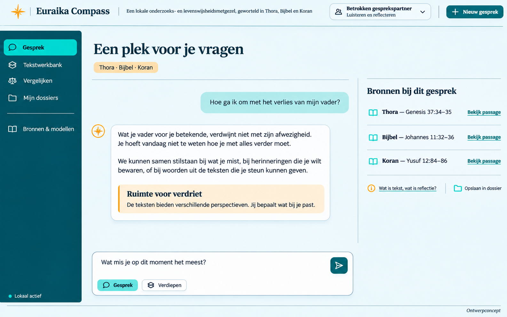
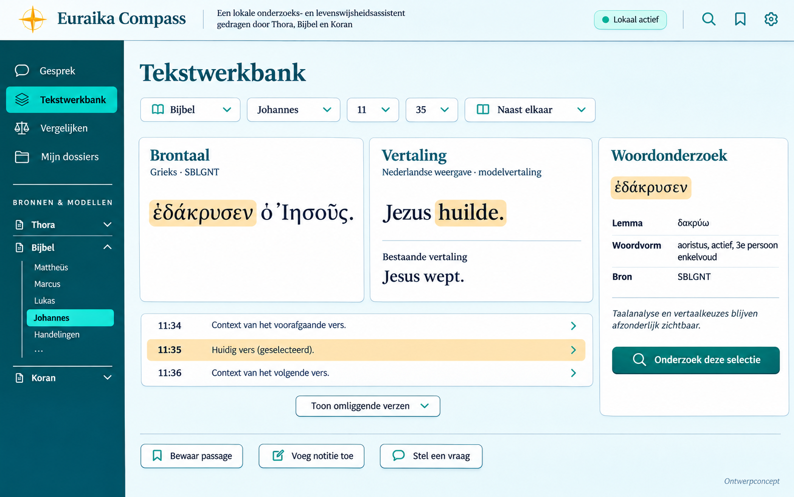
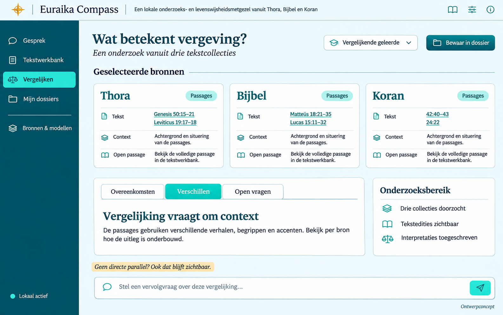

# Euraika Compass

**Explore texts. Understand perspectives. Find direction.**

Euraika Compass is an open-source project for a local research and life-wisdom companion grounded in the Torah, Bible, and Quran. It combines a text workbench with source-linked conversations about meaning, choices, grief, forgiveness, and other questions of life.

**Project stage: planning and UI concepts. There is no runnable application or Pinokio installer yet.** The screenshots below are AI-generated design mockups, not captures of working software. Their example content and analysis labels are illustrative, not validated research results.

## Planned experience

- Read named original-language editions alongside published translations.
- Ask focused passage questions or broader questions across the three collections.
- Open the exact edition and passage behind an answer's citation.
- Inspect translation alternatives and available linguistic annotations.
- Save research dossiers with source, model, and policy versions.
- Install and run locally through Pinokio once the application is implemented.

## Five personas, one impartiality policy

| Persona | Purpose |
| --- | --- |
| Supportive conversation partner | Listening and reflection around personal experiences |
| Wisdom guide | Exploring choices, responsibility, forgiveness, and meaning |
| Text researcher | Investigating language, context, and translation |
| Comparative scholar | Comparing sources and attributed interpretations |
| Critical interlocutor | Examining assumptions and arguments respectfully |

Personas change the style and method of a conversation. They do not adopt a preferred religion. The application will distinguish a textual observation, a published translation, a tradition-specific interpretation, and its own suggested reflection.

Impartiality means consistent standards of evidence and respectful treatment. It does not require equal answer lengths, fabricated parallels, or agreement between traditions. We do not claim that any model is entirely free of bias.

## Design concepts

The current visual direction uses petrol, turquoise, warm amber, and light reading surfaces. Collections receive equal visual prominence.

### Conversations and life questions

### Original texts and translations

### Comparing perspectives

See [design notes and generation prompts](docs/design/README.md) for the concepts' scope and limitations.

## Implementation plan

The [detailed implementation plan](docs/plans/2026-11-08-1552-feat-religion-research-app-plan.md) is written in Dutch. It defines product requirements, candidate models, source packs, eight implementation units, evaluation datasets, and proposed release gates.

The planned stack is React/TypeScript, FastAPI, SQLite/FTS5, a local semantic index, and managed model workers. Qwen3.5 is an initial coordinator candidate; compact embedding, reranking, and translation models are evaluated separately. These are proposals requiring runtime and quality validation, not tested product capabilities.

## Sources and licensing boundaries

The repository initially contains documentation and generated UI concepts. It does not include model weights, scripture corpora, third-party translations, or linguistic datasets.

Those materials retain their own licenses and conditions. Future source packs must record the edition, origin, attribution, coverage, integrity hash, and separate permissions for display, indexing, export, and training. An open-source application license does not grant rights to third-party data or models.

The plan excludes HY-MT1.5 from the standard Belgian/EU deployment because its published community license excludes the EU. Other models and sources are also subject to admission checks before use.

## Evaluation approach

- Test retrieval separately from interpretation and full application behavior.
- Use fixed evidence bundles to test persona, source-order, and irrelevant identity effects.
- Measure factual and citation quality as well as consistent treatment across traditions.
- Include missing sources, contested interpretations, fabricated citations, and attempts to induce religious preference.
- Use blinded human assessment alongside deterministic checks and model-assisted triage.
- Report sample sizes, uncertainty, and outstanding failures; never advertise a proof of perfect neutrality.

See the plan's Verification Contract for dataset sizes, human-review workload, and provisional thresholds.

## Contributing

Contributions to the design, implementation plan, source provenance, linguistic evaluation, and impartiality tests are welcome. Start with a focused issue describing the problem and the relevant plan requirement. Do not contribute private conversations, credentials, model weights, or texts without documented redistribution rights.

Please keep discussion respectful toward people of every religion and none. Preserve meaningful disagreements and support factual corrections with sources.

## License

Project-owned materials are licensed under [Apache License 2.0](LICENSE), except where an individual file explicitly states otherwise. Third-party models, datasets, translations, and source texts are not relicensed by this repository.

Copyright 2026 Euraika Labs.
