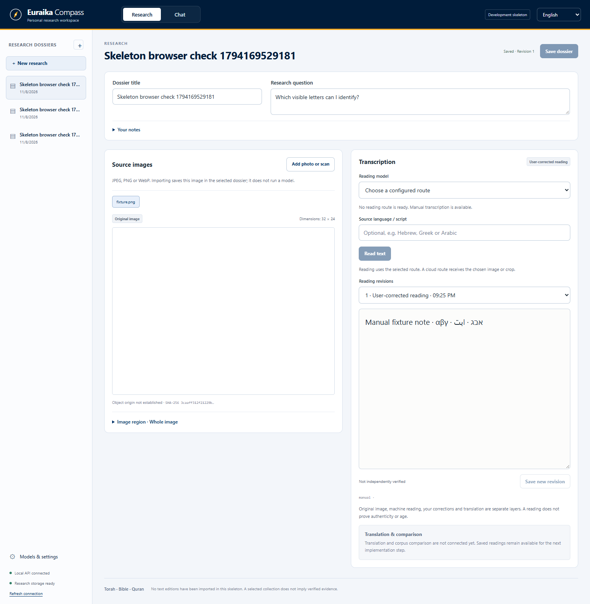
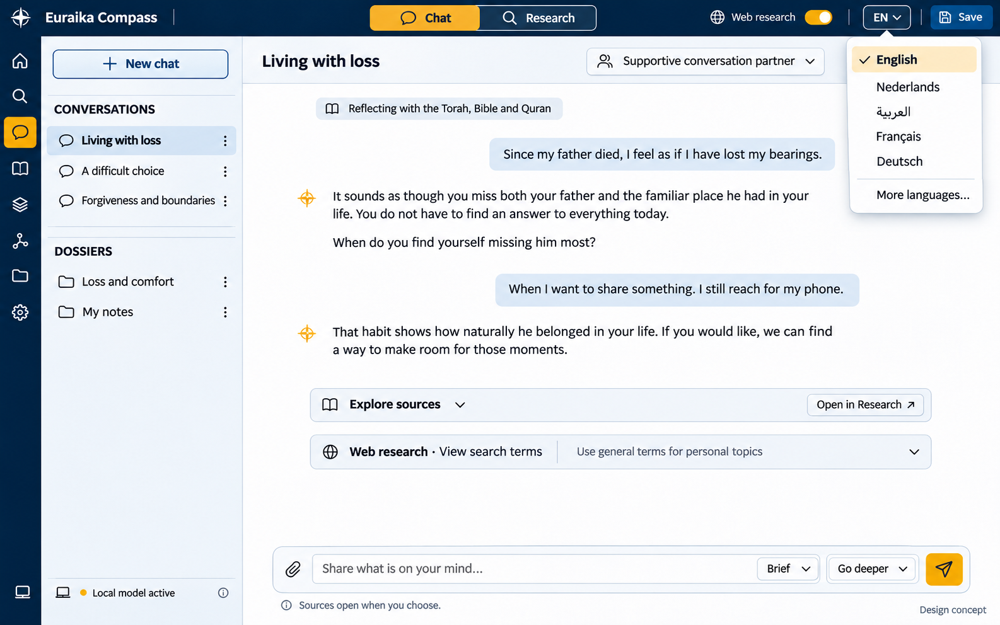
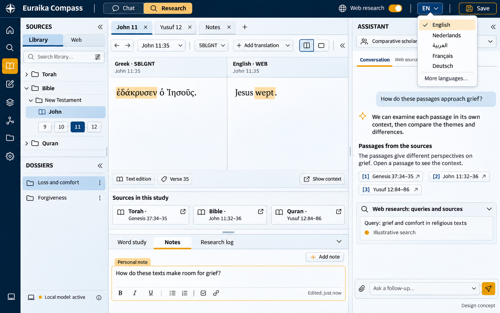
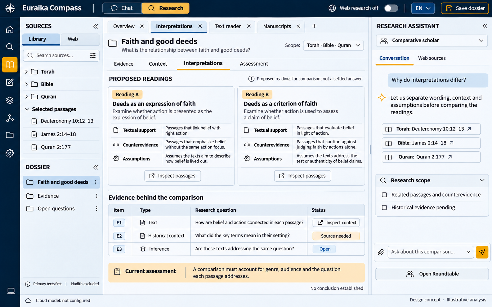
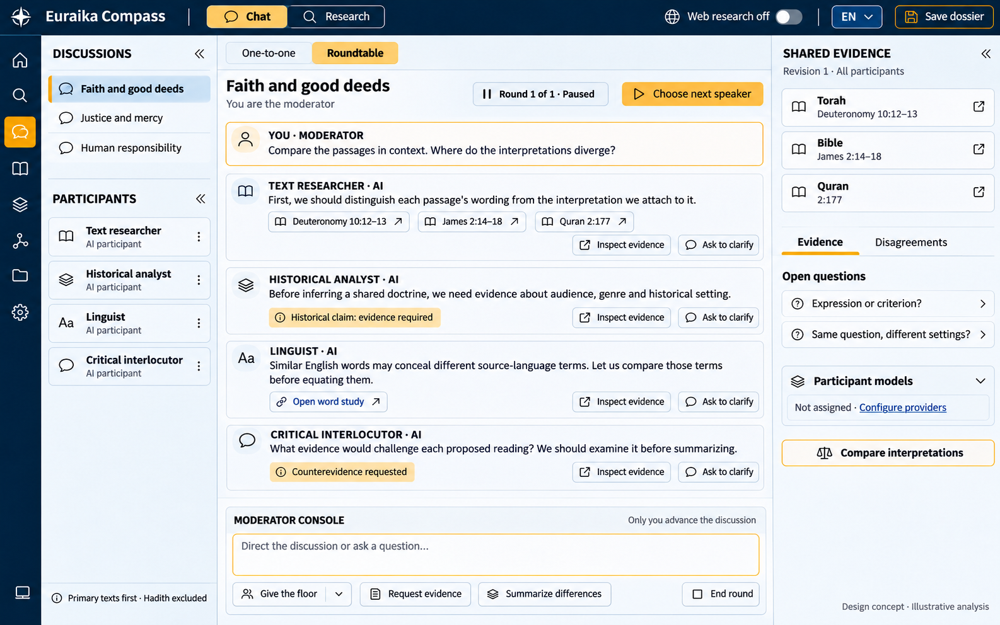

# Euraika Compass

**Explore texts. Compare interpretations. Follow the evidence.**

Euraika Compass is an open-source, locally hosted tool for **personal, neutral theological research** into the Torah, Bible, and Quran. It helps you inspect original texts and manuscripts, compare translations and interpretations, examine historical context and counterevidence, and keep your own research dossiers. You remain the researcher and moderator; AI helps find sources and test arguments without adopting a religious conclusion.

The Research workspace is central. A connected Chat view also supports conversations about meaning, choices, grief, forgiveness, and other life questions. Optional cloud reasoning models work alongside local source, retrieval, and translation services. Authentic, traceable material available online can be used for personal research; institutional publication is not an exclusive admission rule. Practical source and usability checks guide development.

**Project stage: runnable skeleton.** The repository includes the React/TypeScript workbench, FastAPI backend, PostgreSQL/pgvector schema and migrations, private image storage, manual transcript revisions, model registry and transcription-job plumbing. The full research and conversation features below remain the product target; the skeleton does not generate invented answers for unfinished capabilities. No actual model inference or historical-script accuracy has been verified yet.

The screenshots in **Design concepts** remain AI-generated explorations. Their example content and analysis labels are illustrative, not validated research results. A capture of the running skeleton appears below.

## Quick start with Pinokio

1. Download/import `https://github.com/Euraika-Labs/euraika-compass` as a Pinokio app.
2. Choose **Install**. The launcher installs Python 3.12, compatible PostgreSQL 16.15/pgvector 0.8.6 binaries, locked backend dependencies and the frontend build. It does not download model weights or configure API keys.
3. Choose **Start**, then **Open Web UI** when the local server is ready.
4. Create a research dossier, attach your own photo and enter a manual reading. Saving a correction creates a new revision while preserving the original image and earlier text.
5. Use Pinokio's normal **Stop** control when finished. **Reset dependencies** targets generated environments/build files and preserves the separate personal data directory.

The default data directory is per-user local application data, outside the checkout and OneDrive. An external PostgreSQL database can be configured explicitly. See [the development and API guide](docs/development/README.md) for configuration, local commands and model-worker setup. Pinokio Install, Start, Stop, dependency Reset and reinstall were exercised on Windows, including retained dossiers, readings and identical original image bytes. See the [verification record](docs/development/2026-11-08-skeleton-verification.md) for scope and limits.

## Current implementation

| Capability | Skeleton status |
| --- | --- |
| Dossiers and original images | PostgreSQL CRUD, conflict detection, validated private image imports and immutable byte storage are implemented |
| Manual readings and corrections | Implemented as separate transcript revisions; no automatic authenticity or canonical-verification label |
| Model catalog and jobs | Configurable Kraken profiles, local Qwen and Mistral OCR adapters; honest unavailable-route status, job polling/SSE and cancellation |
| Model execution | Requires separately installed/configured readers or endpoints; no model inference has been verified in this work |
| Workbench interface | Research/Chat/Connections scaffolding, localization and RTL; implemented functions are separated from unfinished actions |
| Corpus import, retrieval and grounded chat | Planned; generation endpoints return an explicit unavailable/not-implemented response |
| Autonomous web research and AI Roundtable turns | Planned; no fabricated search results or model discussions |
| Dossier export/import and complete backup UI | Planned; durable storage and migration foundations are present |
| Temporary Chat image attachments | Planned; initial image uploads deliberately require a saved research dossier |

This is the running skeleton with a neutral image-upload fixture and an explicitly manual test reading. It is not manuscript evidence or model output.

[Arabic RTL capture](docs/development/images/skeleton-arabic.png)

## Project documents

| Document | Purpose |
| --- | --- |
| [vision.md](vision.md) | Product purpose, intended users, principles, priorities, and long-term direction |
| [functional.md](functional.md) | Central functional specification: features, user flows, source rules, orchestration, and failure behavior |
| [technology.md](technology.md) | Recommended stack, local/server database choices, durable source assets, autosave, sharing, maintenance, and backup |
| [architecture.md](architecture.md) | Component boundaries, data model, research execution, model routing, jobs/events, API contracts, trust boundaries, and deployment |
| [design.md](design.md) | Interface structure, Euraika design tokens, Chat/Research/Roundtable interactions, source states, localization, and accessibility |
| [Implementation plan](docs/plans/2026-11-08-1552-feat-religion-research-app-plan.md) | Technical approach, implementation units, and practical checks for personal use |
| [Development and API guide](docs/development/README.md) | Running the skeleton, private configuration, tests, API examples and remaining implementation |
| [OCR/HTR and vision model research](docs/research/2026-11-08-ocr-htr-model-selection.md) | Local-first reading candidates for historical Hebrew, Greek and Arabic, optional cloud routes, and practical hardware/domain limits |
| [Design concepts](docs/design/README.md) | UI explorations, saved images, prompts, and their limitations |
| [Full-plan review — 8 November 2026](docs/reviews/2026-11-08-full-plan-review.md) | Historical review and two resolved inconsistencies; its former evaluation assumptions are superseded by the personal-use scope |

## Planned experience

- Read named original-language editions alongside published translations.
- Use a focused **Chat** view for life questions and a flexible **Research** workspace with tabs, resizable panels, sources, and notes. Switch views without losing the conversation or evidence.
- Ask focused passage questions or broader questions across the three collections.
- Let the assistant search and read additional web sources when web research is enabled, with visible queries, provenance, and citations.
- Open the exact edition and passage behind an answer's citation.
- Inspect translation alternatives and available linguistic annotations.
- View genuine historical manuscript scans, including Quran manuscripts, with traceable provenance and separate transcription/translation layers. Original collection catalogs are useful anchors; verified authentic copies from other online hosts are also usable.
- Import a photo/scan or select a consulted source image, choose a page or region, and read its text with an OCR, handwriting or image-capable model route. Inspect uncertain characters beside the image, correct the reading, compare available transcriptions, and translate or research the selected reading separately. This is a core planned feature.
- Compare interpretations through primary-text context, historical/linguistic evidence, counterevidence, and explicit limits, using the same method for all three collections.
- Moderate a **Roundtable** of AI personas and analytical perspectives, with a shared evidence dossier and control over speaking turns and synthesis.
- Save research dossiers with source, model, and policy versions.
- Autosave explicitly started research dossiers; retain consulted source images locally when permitted, with deduplication and provenance. Export/import selected dossier revisions with rights-aware inclusion of source files.
- Install and run locally through Pinokio; the skeleton is available while the complete experience is built in working slices.

English is the default interface language. The initial localization target includes English, Dutch, Arabic, French, and German, with an extensible language catalog. Interface language, conversation language, and source/translation language are independent settings. Arabic includes right-to-left interface behavior; original Hebrew and Arabic passages retain their own reading direction in every interface language. Practical examples check each used language; untested output and translation limits remain visible.

Local-only operation remains available. Cloud reasoning is explicitly configured and sends the selected conversation context and permitted evidence to the selected provider. Web research and remote manuscript viewing have separate controls. Search uses minimized topic terms rather than forwarding whole personal conversations; this differs from context sent to a configured conversation model. Search results supplement admitted editions. See the [interaction/language specification](docs/design/interaction-and-localization.md) and [evidence method, hybrid models, and moderated discussion](docs/plans/research-method-and-model-architecture.md).

Hadith is excluded from default Quran retrieval and interpretive authority. No hadith pack is admitted; the narrow possible exception requires individually established direct provenance and permits context only. Later commentary does not automatically override primary text in any collection. Explaining an attributed interpretation differs from adopting its authority. Genuine manuscript candidates and image-rights limitations are documented in the [source register](docs/sources/manuscript-register.md).

### Reading text from photos and scans

The original image stays unchanged. Automatic transcription, your corrections, reconstruction and translation are separate versions linked to the chosen page/region and the engine/model used. Unreadable text remains uncertain; a known scripture passage must not silently replace what can actually be seen. A machine reading does not establish the object's authenticity or age, and successful recognition does not make it a verified quotation. Photos with unknown provenance can still be examined with that limitation visible.

Use a suitable local reader or an explicitly selected, configured image-capable route. The adapters and job flow are present, but the initial candidates below still need a real runtime and photo trial; support for every ancient script is not assumed. Local-only mode prevents cloud image calls. In the skeleton, initial uploads belong to an explicitly saved dossier; temporary Chat uploads are planned separately. The complete image-reading flow retains the selected original, regions and reading revisions for later reference.

The [8 November model research](docs/research/2026-11-08-ocr-htr-model-selection.md) recommends starting with local Kraken 7.1 / historical PP-OCRv6 medium and matching script profiles, with local Qwen3.8-27B as a second image reader. Mistral OCR 4.1 and selected configured vision APIs are optional comparisons. These are sourced starting choices; no reading accuracy or runtime on our own photos has been measured yet.

## Five personas, one impartiality policy

| Persona | Purpose |
| --- | --- |
| Supportive conversation partner | Listening and reflection around personal experiences |
| Wisdom guide | Exploring choices, responsibility, forgiveness, and meaning |
| Text researcher | Investigating language, context, and translation |
| Comparative scholar | Comparing sources and attributed interpretations |
| Critical interlocutor | Examining assumptions and arguments respectfully |

Personas change the style and method of a conversation. They do not adopt a preferred religion. The application will distinguish a textual observation, a published translation, a tradition-specific interpretation, and its own suggested reflection.

Impartiality means consistent standards of evidence and respectful treatment. It does not require equal answer lengths, fabricated parallels, or agreement between traditions. We do not claim that any model is entirely free of bias.

## Design concepts

The current direction uses the Euraika brand palette: navy `#001C3A`, secondary blue `#003369`, and gold `#F4A616`, with light reading surfaces. These colors were checked against the [Euraika website](https://www.euraika.net/) on 8 November 2026. Collections receive equal visual prominence. The English concepts below replace the earlier petrol/turquoise direction.

### Conversations and life questions

### Research, original texts, and translations

### Theological research and interpretation

### User-moderated Roundtable

See also the [orchestrator role-allocation concept](docs/design/compass-orchestrator-routing-v5.png). It shows demo connections and provisional assignments only, not actual account access or evaluated model rankings.

See [design notes and generation prompts](docs/design/README.md) for the concepts' scope and limitations.

## Implementation plan

Start with [functional.md](functional.md), the central specification for personal theological research, user flows, source and interpretation rules, and failure behavior. The orchestrator allocates roles only among user-configured, enabled and eligible models. Task capabilities, user choices, data settings and budget guide assignments; small practical comparisons can inform role fit without a mandatory benchmark. Manual overrides and pinned roles remain available. A failed pinned role stays paused until you explicitly unpin or reassign it.

The [detailed implementation plan](docs/plans/2026-11-08-1552-feat-religion-research-app-plan.md) is written in Dutch. It defines product requirements, candidate models, starter sources, eight implementation units, and practical source, interpretation, UI and persistence checks. There is no fixed test volume, required expert panel or statistical certification program for personal use.

The implemented stack foundation is React/TypeScript with Vite, Python/FastAPI, SQLAlchemy/Alembic and PostgreSQL with full-text/pgvector schema support. End-to-end corpus retrieval and local model installation remain unfinished. PostgreSQL is the primary database for both local and future server deployments. The wider candidate model pool includes Mistral, Alibaba Cloud/Qwen/GLM, OpenAI, Anthropic, MiniMax, and optionally OpenRouter as a gateway; catalog presence does not mean every inference adapter is implemented. Local Qwen remains a coordinator/vision option; embedding, reranking, and historical-language translation candidates are tried separately. No provider/model has been selected as a validated reading winner. API keys belong in backend-only local configuration, never this repository.

The [storage architecture](technology.md) keeps large source objects outside PostgreSQL. The skeleton stores original dossier images once by hash and preserves transcript revisions. Broader source-retention, export/import and complete backup/restore flows remain planned; a later opt-in sharing service is separate. Native Windows PostgreSQL 16.15 with pgvector 0.8.6 and the Pinokio install/start/stop/reset lifecycle have been exercised. Neither cache permission nor private-study access automatically permits redistribution.

## Sources and licensing boundaries

The repository contains application source, configuration metadata, documentation and generated UI concepts. It does not include model weights, scripture corpora, third-party translations, or linguistic datasets. Open-source code and documentation do not make your personal dossiers or downloaded research material public.

Online sources may include primary texts, manuscript scans, articles, author archives, project repositories and documented interpretations. Record identity, origin, edition and source type. Institutional and academic catalogs are preferred provenance references where available, not the only permitted hosts. Authenticity means the material is genuine and traceable; it does not establish the truth of every claim or give an interpretation automatic authority.

Personal consultation is separate from permanent copying, external model processing, redistribution and training. Keep actual access and use constraints with each source; unknown publication or training rights do not automatically block personal reading. Use the source link where a particular operation is restricted, and do not bypass access controls. Files included in a shared dossier or public repository need their own applicable reuse permission. Source packs record edition, attribution, coverage and integrity alongside those constraints. The application license does not relicense third-party material.

The plan excludes HY-MT1.5 from the standard Belgian/EU deployment because its published community license excludes the EU. Other models and sources are also subject to admission checks before use.

## Practical quality checks

- Open citations and compare literal quotes against the named edition.
- Try a small, growing set of your own research questions, including disputed readings and counterevidence.
- Check that observations, hypotheses, attributed interpretations and personal reflections remain distinct.
- Repeat a question with another persona or source order when investigating possible religious preference.
- Try missing or unreachable sources, failed model calls, network-off settings and the pinned-role rule.
- Compare a few model translations with published translations and available language evidence; keep untested quality visible.
- Try clear, rotated, blurred and partially unreadable photos. Check image regions, manual correction, separate translation and reopening of the saved original; verify that a missing local reader cannot silently upload to a cloud route.
- Follow a real question through Research, the source/manuscript viewer, a saved dossier, restart and reopening. Check the used languages, RTL and keyboard controls.
- Record concrete problems and repeat affected examples after a fix. A second model or specialist can help, but no panel approval is required to use the tool.

See the plan's Verification Contract for V1-V9. These checks support your investigation; they do not certify a theological conclusion or prove perfect neutrality.

## Contributing

Contributions to the design, implementation plan, source provenance, linguistic evaluation, and impartiality tests are welcome. Start with a focused issue describing the problem and the relevant plan requirement. Do not contribute private conversations, credentials, model weights, or texts without documented redistribution rights.

Please keep discussion respectful toward people of every religion and none. Preserve meaningful disagreements and support factual corrections with sources.

## License

Project-owned materials are licensed under [Apache License 2.0](LICENSE), except where an individual file explicitly states otherwise. Third-party models, datasets, translations, and source texts are not relicensed by this repository.

Copyright 2026 Euraika Labs.
