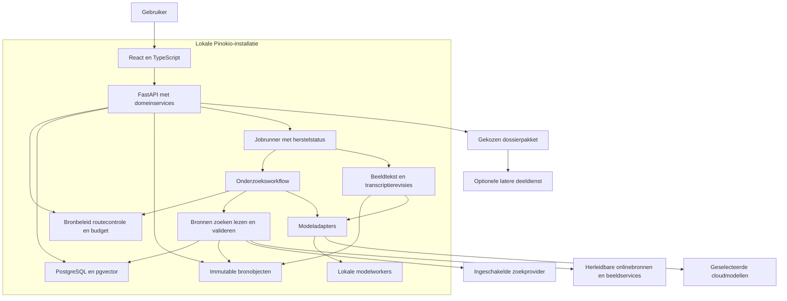
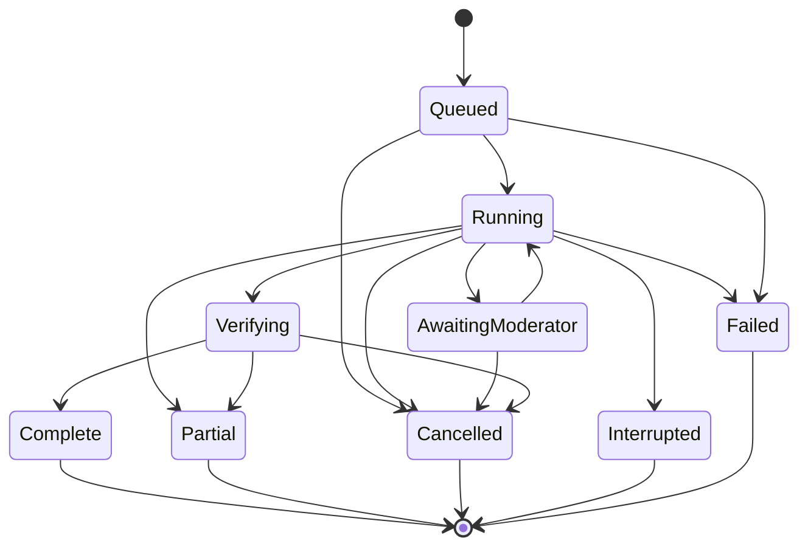

# Euraika Compass — Systeemarchitectuur

Status: architectuur voor een persoonlijke, neutrale theologische onderzoekstool, bijgewerkt op 9 november 2026. De werkende basis bevat dossier-/beeldbewaring, leesrevisies, privémodelverbindingen, corpusimport, PostgreSQL-zoeking, modelgestuurde relevantieselectie, chat met bronmomentopnamen en expliciet bewaarde gesprekken. Een aparte optie in Chat haalt online bewijs op met een beperkte zoekdekking. Mistral Large 4.0 is gekoppeld; de gekozen verbinding blijft gedurende een antwoord vastgezet. Vectorretrieval, gegenereerde AI-Roundtable, dossierexport en lokale modelinstallatie blijven verdere bouwstappen. Zie de [chatgids](docs/development/grounded-chat.md) en [actuele implementatiegrenzen](docs/development/README.md).

## 1. Plaats van dit document

| Document | Verantwoordelijkheid |
| --- | --- |
| [vision.md](vision.md) | Doel, doelgroep en richting |
| [functional.md](functional.md) | Leidend functioneel gedrag en bronbeleid |
| [technology.md](technology.md) | Stack, databasekeuze, opslag, onderhoud en technische randvoorwaarden |
| `architecture.md` | Samenhang, grenzen, contracten en uitvoering van het systeem |
| [design.md](design.md) | Schermen, interacties, vormgeving en toegankelijkheid |
| [Implementatieplan](docs/plans/2026-11-08-1552-feat-religion-research-app-plan.md) | Bouwvolgorde, requirements R1-R28 en verificatie V1-V9 |

Technische uitwerking mag het functionele contract niet stilzwijgend wijzigen. De skeleton bevat gelockte dependencies, een eerste migratie en werkende dossier-/beeld-/transcriptiecontracten. De overige endpointnamen hieronder blijven bouwvoorstellen; de actuele OpenAPI op `/openapi.json` en de [ontwikkelhandleiding](docs/development/README.md) tonen wat al is aangesloten en wat expliciet niet geïmplementeerd is.

## 2. Architectuurkeuze

Een modulaire Python/FastAPI-backend bedient een statisch gebouwde React/TypeScript-interface. PostgreSQL is de primaire database, ook in de lokale Pinokio-installatie. PostgreSQL full-text search en pgvector verzorgen de zoekrepresentaties. Grote bronbestanden staan buiten de database in een beheerde objectopslag. Afzonderlijke beheerde workers voeren langdurig onderzoek, downloads, indexering en lokale modeltaken uit.

De backend bezit beleid, bronrechten, gegevensselectie, budgetten, uitvoering en opslag. Een LLM kan onderzoekstappen en roltoewijzingen voorstellen; uitvoerbare bevoegdheid blijft bij de backend. De browser krijgt geen directe databaseverbinding of providercredentials.

De lokale installatie voor persoonlijk onderzoek is de eerste uitvoeringsvorm. Een eventuele latere centrale deelomgeving kan domeinlogica en opslaginterfaces hergebruiken en krijgt eigen authenticatie en toegangscontrole. Zij is geen voorwaarde voor de lokale app. Er is geen directe synchronisatie van PostgreSQL-datadirectories of automatische publicatie van lokale dossiers.

## 3. Componenten en eigenaarschap

| Component | Bezit | Mag niet zelfstandig beslissen |
| --- | --- | --- |
| Webinterface | Presentatie, paneel-/tabstate, conceptinvoer, zichtbare gebruikerskeuzes | Bronrechten toekennen, inactieve modellen gebruiken of rechtstreeks providercalls uitvoeren |
| API-/applicatielaag | Gevalideerde opdrachten, workspacecontext, idempotentie, antwoord-/eventcontracten | Een onvolledige run als voltooid presenteren |
| Dossierservice | Onderzoek, drafts, revisies, notities en bewuste opslag van gesprekken | Tijdelijke persoonlijke gesprekken stilzwijgend duurzaam bewaren |
| Bronservice | Herleidbare bronnen, edities, bronrevisies, authenticiteitsinformatie, bekende gebruiksbeperkingen en passagecontext | Authenticiteit van een document gelijkstellen aan waarheid of uitlegautoriteit van zijn beweringen |
| Assetservice | Download, hash, herkomst, afgeleiden, retentie en beschikbaarheid | Bewaarrecht gelijkstellen aan deel- of cloudverwerkingsrecht |
| Beeld-/transcriptieservice | Foto-/scanimport, regioselectie, OCR/HTR- of visionopdracht en gescheiden transcriptie-/correctierevisies | Ontbrekende letters aanvullen als waargenomen tekst, OCR als bronauthenticatie behandelen of een beeld stilzwijgend naar een cloudroute sturen |
| Retrievalservice | Collectiescope, tekst-/vectorzoeken, kandidaten, deduplicatie en zoekdekking | Ontbrekend corpus vervangen door ongemarkeerd modelgeheugen |
| Bewijsservice | Versievaste bewijsbundels, claims, verwijzingen en interpretatierelaties | Modelovereenstemming als bronbewijs tellen |
| Onderzoeksworkflow | Begrensde stappen, toolplanning, verificatie en terminale toestanden | Beleid of moderatorregie laten overschrijven door broninhoud |
| Routeringsservice | Beschikbare geschikte routes, praktische kwaliteitsnotities, toewijzingen, pins en toegestaan fallbackbeleid | Ongekoppelde providers activeren of een vastgezette rol automatisch herverdelen |
| Modeladapters/workers | Uitvoering van toegelaten opdrachten en genormaliseerde resultaten | Secrets in modelcontext opnemen of zelf nieuwe tools/rechten verkrijgen |
| Roundtableservice | Deelnemers, beurten, rondes, gedeeld bewijs en meningsverschillen | Ongevraagd een debat voortzetten of een winnaar uitroepen |
| Export-/backupservice | Geselecteerde pakketten, manifesten, consistente snapshots en herstel | Secrets of geblokkeerde bronbytes meenemen in een deelpakket |

Dit zijn interne modules en grenzen; zij vereisen niet ieder een netwerkservice. De eerste versie heeft geen verplichte microservice-, Redis- of externe vectordatabaselaag.

## 4. Domein- en opslagmodel

Persoonlijke onderzoeksobjecten hebben een workspace-/eigenaarscope. De lokale versie start met één workspace. Toekomstige centrale autorisatie wordt ook toegepast bij zoeken en bestandslevering; alleen een gefilterde lijst in de UI is onvoldoende.

| Domein | Kernobjecten en relaties |
| --- | --- |
| Teksten | Work → Edition → SourceRevision → Passage; CollectionMembership en Alignment bewaren scope en referentiesystemen |
| Manuscripten | Manuscript → Folio/Canvas → AssetOrigin; een passagekoppeling heeft een aantoonbare mapping en onzekerheidsstatus |
| Bronbestanden | Blob identificeert bytes; AssetOrigin koppelt die aan een bron, rechten en herkomst; afgeleiden verwijzen naar hun ouder |
| Beeldtekst | TranscriptionJob gebruikt een beeldrevisie en optionele regio; TranscriptionRevision bewaart uitvoerder, taal/schrift, tekst, onzekere delen en beschikbare regios; een eigen correctie verwijst naar de vorige revisie |
| Onderzoek | Dossier → Draft en DossierRevision; ResearchRun gebruikt een EvidenceBundleRevision en levert claims/interpretaties/resultaten |
| Bewijs | EvidenceItem verwijst naar een exacte bronrevisie/locatie; Citation koppelt een claim aan dat bewijs; steun en tegenbewijs zijn afzonderlijk zichtbaar |
| Discussie | Participant, RoleAssignment, Round, Turn en Message verwijzen naar modelroute en gebruikte bewijsversie |
| Uitvoering | Job, Attempt, RunEvent en UsageRecord leggen voortgang en verbruik vast; credentials blijven afzonderlijke secrets |

Bronrevisies, aangehaalde bytes en afgeronde onderzoeksresultaten worden niet in plaats gewijzigd. Een nieuwe analyse of gewijzigde bron maakt een nieuwe revisie. Drafts hebben gecontroleerde updates met een verwachte revisie; een versieconflict levert een expliciete conflictrespons op en overschrijft geen nieuwer werk.

Zoeknormalisatie, `tsvector` en embeddings zijn afleidingen. Hun keys bevatten bron-, chunking-, model- en indexrevisies. Originele tekst/diakritiek blijven intact. Exact vectorzoeken is de eerste baseline; approximate indexen worden pas na recall-/performanceproeven toegelaten.

Een gedeelde blobhash betekent dezelfde bytes, niet dezelfde licentie, wetenschappelijke betekenis of toegangsrechten. Bestandslevering verloopt via een bevoegde bron-/assetreferentie; een hash alleen is geen toegangsbewijs. Een dossier gebruikt pointers naar bestaande objecten in plaats van kopieën van iedere scan per bericht.

## 5. Gegevenslevensduur en privacy

| Toestand | Inhoudelijke bewaring | Herstel |
| --- | --- | --- |
| Tijdelijke Chat | Gespreksinhoud en inhoudelijke events blijven in de actieve sessie; geen automatische DB-dossieropslag | Herverbinding zolang de sessie leeft; geen belofte van herstel na appherstart |
| Tijdelijke beeldbijlage | Foto en gegenereerde transcriptie horen bij de sessie; begrensde private tijdelijke staging kan nodig zijn voor verwerking | Opruimen na sessie/taak volgens zichtbaar tijdelijk beleid; geen opname in de gedeelde bronnenbank |
| Alleen Research-weergave openen | Behoudt de opslagstatus van het bestaande gesprek | Een layoutwissel maakt geen dossier of nieuwe modelrun |
| `New research` of `Save as dossier` | Expliciete dossieraanmaak; daarna automatische draft-/resultaatbewaring | Onderbroken runs en bevestigde drafts blijven heropenbaar |
| Openbare toegelaten bronobjecten | Rechtenbewust herbruikbaar, los van persoonlijke promptinhoud | Alleen lokaal aanwezige bytes krijgen een offlineclaim |
| Dossierexport | Alleen geselecteerde revisie, persoonlijke inhoud en toegelaten objecten | Import als afzonderlijke herkomst/revisie |

Technische gebruiksregistratie mag status, foutcode, route-ID en kosten bevatten, maar geen ongevraagde persoonlijke vraagtekst. Een taakrecord voor tijdelijke Chat is geen achterdeur om die inhoud of een volledige eventstream te bewaren. Persoonlijke context wordt alleen aan een expliciet gekozen cloudroute geleverd. Zoekproviders krijgen geminimaliseerde onderwerptermen; dit is een andere gegevensstroom dan cloudgesprekscontext.

Modelkeuze, webonderzoek en remote manuscripttoegang hebben aparte instellingen. Local-only verhindert uitgaande model- en zoekopdrachten. Webonderzoek vereist daarnaast activering per chatvraag. De backend stuurt alleen korte zoektermen naar de zoekdiensten en houdt geciteerde webfragmenten en hun herkomst gescheiden van het corpus. Secrets worden via backendinstellingen opgeslagen en nooit teruggeleverd in statusresponses, prompts, dossierpakketten of diagnostiek.

Een eigen foto blijft een persoonlijke upload, ook als dezelfde bytes elders bestaan. Een hash maakt haar geen openbaar bronobject. Bij expliciet bewaren als onderzoek worden gekozen originele bytes, afgeleiden en transcriptierevisies aan het dossier gekoppeld. Een layoutwissel of geslaagde OCR-opdracht verandert de bewaarkeuze niet. Beeldverwerking via een gekozen cloudroute toont of het hele beeld of een uitsnede wordt verzonden; lokale modus staat geen stille cloudfallback toe.

## 6. Onderzoeksworkflow en bewijscontrole

1. Valideer vraag, scope, opslagstatus, verbindingen en uitvoeringsbudget.
2. Maak bij duurzaam onderzoek de run en bijbehorende job atomair aan; leg gebruikte bron-/policy-/routeconfiguratie vast.
3. Bepaal de geschikte routes en benodigde bron-/taalhulpmiddelen. Een exacte passagevraag hoeft geen volledig thematisch zoektraject te starten.
4. Onderzoek iedere gevraagde collectie met context, gerelateerde passages en tegenbewijs. Toegestane webbronnen worden echt gelezen; zoeksnippets blijven leads.
5. Leg de bewijsbundel vast met bronlocaties, type bewijs, onzekerheid, dekking en gebruiksstatus. Overlappende passagefamilies worden niet als onafhankelijke bewijzen dubbel geteld.
6. Laat het gekozen model voorgestelde lezingen/claims maken op basis van die bundel. Gebruik een tweede model alleen binnen de ingestelde opdracht en budgetten.
7. Valideer verwijzingen, edities, citaatbereiken en gebruiksrechten; vul letterlijke citaten vanuit de opgeslagen editie in. Beoordeel inhoudelijke ondersteuning afzonderlijk.
8. Toon het antwoord met onderbouwing, verschillen en beperkingen en bewaar bij een dossier een nieuwe resultaatrevisie.

Dezelfde bronregels gelden voor alle persona's en collecties. Hadith is standaard uitgesloten en geen uitlegautoriteit; de beperkte mogelijke contextuele uitzondering vereist afzonderlijke toelating volgens [functional.md](functional.md). Een website of deelnemer kan die grens niet omzeilen. Latere interpretaties kunnen onderwerp van vergelijking zijn zonder daarmee gezag over de primaire tekst te krijgen.

Een providerstream is conceptuitvoer. Status en een passende niet-inhoudelijke erkenning kunnen direct verschijnen; substantieve schriftclaims worden pas na broncontrole weergegeven. De UI ontvangt gevalideerde inhoudsblokken en bronrelaties, geen ongemarkeerde ruwe modelclaims of verzonnen verborgen redeneertranscripten.

### Van foto of scan naar onderzochte tekst

Beeldtekst lezen is een kernroute onder R28. De gebruiker importeert een foto of kiest een reeds geraadpleegde scan, selecteert een pagina of regio en start een afzonderlijke transcriptieopdracht. De assetservice bewaart de oorspronkelijke bytes met hash en opgegeven herkomst. Rotatie, uitsnede of contrastbewerking zijn afgeleiden met hun bewerkingsgegevens en coördinaattransformatie naar het origineel; zij vervangen dat origineel niet.

De backend kiest een beschikbare lokale beeldtekstworker of een door de gebruiker ingestelde, ingeschakelde route met de benodigde beeld-/schriftmogelijkheden, binnen gegevenskeuze en budget. Een gewoon tekstmodel wordt geen beeldlezer omdat een prompt dat vraagt. De bestaande pinregel geldt voor een vastgezette route. Als de gebruikte schrijfwijze, taal of beeldkwaliteit niet wordt ondersteund, volgt een concrete beperking en eventueel een handmatige transcriptieroute; geen verborgen provideractivering.

De TranscriptionRevision bevat beeldhash/revisie, pagina/regio, verwerkingsinstellingen, engine-/modelversie, gekozen of voorgestelde taal/schrift en gegenereerde tekst. Onzekere of onleesbare delen blijven herkenbaar. Regio-/regelcoördinaten worden alleen bewaard als de uitvoerder of gebruiker ze werkelijk levert; ontbrekende mapping of zekerheid wordt niet verzonnen. Uitvoerderscores worden hoogstens als hun eigen schatting getoond, niet als gemeten historische juistheid. Handmatige correcties maken nieuwe revisies met behoud van de oorspronkelijke uitvoer.

Beeld, automatische transcriptie, eigen correctie, aangeleverde wetenschappelijke transcriptie, vertaling en eventuele reconstructie blijven aparte lagen. Bekende schriftteksten mogen als vergelijking worden opgehaald, maar vullen geen onleesbare letters stilzwijgend aan. Vertaling en interpretatie verwijzen naar de gebruikte transcriptierevisie; een onzekere lezing blijft ook downstream onzeker. Een machinelezing is geen gecontroleerd letterlijk citaat uit een gepubliceerde editie. Een expliciete gebruikerscontrole geldt alleen voor het nagekeken tekstbereik; zij bewijst geen authenticiteit, ouderdom of auteurschap van het gefotografeerde object.

## 7. Orchestrator en Roundtable

De backend filtert modelroutes eerst op koppeling, ingeschakelde status, account/regio, benodigde mogelijkheden, gekozen gegevensbeleid, concrete bronbeperkingen en budget. De orchestrator kiest uitsluitend route-IDs uit die lijst. Ook de orchestratorroute zelf moet daaraan voldoen. Een LLM-antwoord dat een onbekende route noemt wordt geweigerd. Een voorafgaande expertbeoordeling of benchmarkscore is geen voorwaarde om een gekoppeld model persoonlijk te gebruiken.

Een RoleAssignment bevat persona, perspectief, modelroute/revisie, bewijsversie, automatische of handmatige keuze en pinstatus. Eerdere gebruiksproeven, taak-/taalmogelijkheden en gebruikersvoorkeur helpen bij de keuze; zonder relevante observaties heet de match voorlopig. Een model- of configuratiewijziging maakt oude kwaliteitsnotities mogelijk achterhaald, zonder de persoonlijke tool op een nieuw evaluatieprogramma te laten wachten. Meerdere rollen mogen één model gebruiken en worden niet als onafhankelijke deskundigen voorgesteld.

Een moderatoropdracht autoriseert één beurt of een expliciet begrensde ronde. De standaardvoorstelgrootte blijft vier deelnemers met één antwoord per aangevraagde ronde. Bewijsmateriaal heeft een vaste revisie per beurt. Nieuw bewijs wordt toegelaten en gedeeld voordat afhankelijke reacties volgen. Een synthese is een afzonderlijke gevraagde handeling en bewaart geschillen.

Uitschakelen van een route verhindert volgende opdrachten. Bij uitval pauzeert de rol. Alleen bij een niet-vastgezette rol mag vooraf toegestaan fallbackbeleid een andere eligible route kiezen en de wijziging zichtbaar maken. Een vastgezette rol blijft gepauzeerd totdat de gebruiker haar expliciet vrijgeeft of opnieuw toewijst, ook als een toegestane alternatieve route beschikbaar is. De backend blokkeert automatische hertoewijzing en modelcalls naar een vervanger zolang de pin geldt; handmatige hertoewijzing doorloopt dezelfde toelatingscontroles. Annuleren kan reeds verzonden context of reeds berekende providerkosten niet ongedaan maken.

## 8. Jobs, herstel en eventstromen

Dit is het kernmodel, geen volledige uitputtende toestandslijst. `AwaitingModerator` doet geen nieuwe modelcalls. Pauze/annulering wordt als opdracht bevestigd; de terminale toestand volgt pas wanneer uitvoering is afgebroken of als onzeker is geregistreerd. Een mislukking of herstart gedurende andere actieve fasen kan eveneens Interrupted/Failed opleveren en krijgt transitieproeven.

Workers claimen persistente jobs atomair en gebruiken een lease/attempt-ID met heartbeat. De voltooiing controleert dat de lease nog geldig is, zodat een verouderde worker geen later resultaat overschrijft. Kortstondige rijvergrendeling, bijvoorbeeld `FOR UPDATE SKIP LOCKED`, dient jobclaiming; zij blijft niet open tijdens een modelcall. [PostgreSQL locking-clause](https://www.postgresql.org/docs/current/sql-select.html).

Interne opdrachten gebruiken een workspace-gebonden idempotentiesleutel. Herhaling van een browserrequest of eventherverbinding maakt niet opnieuw een betaalde run aan. Dit levert geen algemene exactly-once-garantie voor externe providers op: bij onbekende cloudafloop wordt de poging als onzeker gemarkeerd en niet blind opnieuw uitgevoerd.

HTTP-opdrachten starten werk; SSE levert voortgang met oplopende event-ID, run-ID, eventtype, payloadschemaversie en tijdstip. Duurzame dossiers kunnen bevestigde events herhalen vanaf een cursor; bij een verlopen cursor wordt eerst de actuele runstatus opgehaald. Tijdelijke Chat heeft alleen sessiegebonden replay. Streamingchunks worden gebatcht/gecheckpoint, niet elk afzonderlijk als DB-transactie geschreven. [FastAPI SSE](https://fastapi.tiangolo.com/tutorial/server-sent-events/).

## 9. API-grenzen

Voorgestelde routes onder `/api/v1`; werkende OpenAPI-contracten en de bijbehorende schermen worden per functie samen uitgewerkt en praktisch gecontroleerd.

| Opdracht | Contract |
| --- | --- |
| `GET /capabilities` | Redacted mogelijkheden, toegelaten routes, connectiestatus en beperkingen; geen secrets |
| `POST /conversations` | Tijdelijke sessie aanmaken zonder stilzwijgend dossier |
| `POST /dossiers` | Expliciet duurzaam onderzoek beginnen of geselecteerde chatinhoud bewaren |
| `PATCH /dossiers/{id}/draft` | Gevalideerde draftupdate met verwachte revisie en bevestigde bewaartoestand |
| `POST /research-runs` | Scope, dossier-/sessiereferentie, opdracht en idempotentiesleutel; retourneert run-ID |
| `GET /runs/{id}` en `GET /runs/{id}/events` | Status/snapshot en bevoegde eventstream |
| `POST /runs/{id}/cancel` | Annulering aanvragen zonder voltooiing voor te wenden |
| `POST /roundtables/{id}/commands` | Begrensde moderatoractie met verwachte discussie-/bewijsversie |
| `GET /sources/{id}` en `GET /passages/{id}` | Exacte revisie, bronlocatie, dekking, rechten en toegelaten inhoud |
| `GET /assets/{origin_id}` | Bestandslevering via bevoegde bronherkomst met juiste representatie/attributie |
| `POST /image-imports` | Begrensde foto-/scanbijlage in sessie- of dossierscope; oorspronkelijke bytes, herkomst en tijdelijke of duurzame bewaarkeuze |
| `POST /transcription-jobs` | Beeldrevisie, pagina/regio, taal/schrift en gekozen geschikte route; retourneert job-ID voor voortgang/annulering |
| `POST /transcriptions/{id}/revisions` | Eigen correctie met verwachte revisie en expliciet gecontroleerd bereik; oude machinelezing blijft behouden |
| `POST /dossiers/{id}/exports` | Een gekozen revisie en expliciete inhoudsselectie naar exportjob |
| `POST /imports` | Begrensd pakket controleren en als afzonderlijke herkomst importeren |

Gedeelde foutenvelop: stabiele code, gelokaliseerbare berichtsleutel, veilige details, request-ID, eventuele run-ID en retry-status. Onderscheid validatiefout, revisieconflict, ontbrekende capability, geweigerd brongebruik, budgetlimiet, providerfout en opslagfout. Verberg credentials en persoonlijke inhoud in technische foutdetails.

Types worden eenvoudig gehouden en waar passend uit backendcontracten afgeleid. TypeScript vervangt geen runtimevalidatie van model-, browser-, bron- of importgegevens. De afgesproken beperkte lint-/typecontrole staat in [technology.md](technology.md).

## 10. Assetpipeline, citaties en retentie

De bronservice registreert authentieke, herleidbare onlinebronnen voor persoonlijk onderzoek. Bibliotheek- en wetenschappelijke catalogi zijn waar beschikbaar de voorkeursreferentie, maar een controleerbare auteurssite, eigenaars-/projectrepository of kopie met aantoonbare herkomstketen kan ook worden gebruikt. Er is geen institutionele allowlist als exclusieve ingang. Onbekende of gegenereerde beelden worden niet als echte manuscriptgetuigen opgevoerd. De service bewaart bronsoort, authenticiteitsonderbouwing en concrete gebruiksbeperkingen; een echt document is niet automatisch inhoudelijk juist.

De assetservice downloadt via beschikbare toegang begrensd naar staging, controleert inhoud, berekent een hash en plaatst bytes onder hun identiteit. De DB-transactie koppelt vervolgens herkomst/gebruiksinformatie en dossierverwijzing. Bestandssysteem en database hebben geen gezamenlijke transactie: herstel behandelt verweesde staging/objecten en ontbrekende blobs expliciet. Persoonlijk raadplegen vereist geen publieke herdistributielicentie; toegang wordt niet omzeild en bewaren, cloudverwerking, delen en training blijven afzonderlijke gebruiksvormen.

Een verwijzing naar tekst noemt editie-/bronrevisie, passage en een vastgelegd selectorreferentiesysteem. Beeldverwijzingen noemen manuscript, canvas/folio, beeldrepresentatie en alleen onderbouwde regioselectoren. Een preview, crop of samengestelde tegelweergave is een afgeleide met ouderrelatie. Een moderne versnummering levert niet automatisch een exacte manuscriptregio.

Gebruikte toegelaten duurzame objecten krijgen een RetentionPin voor relevante dossier-/backuprevisies. Tijdelijke cache heeft eigen quota en opruimregels. Verwijderen controleert daadwerkelijke referenties; een hash alleen is geen voldoende retentieteller. Gewijzigde bronbytes maken een nieuwe revisie. Rechtenwijziging, volle schijf en onbereikbaarheid krijgen een beschikbaarheidsstatus zonder geciteerd materiaal stilzwijgend te vervangen.

## 11. Vertrouwensgrenzen en rechten

Browser, broninhoud, provideruitvoer en importpakketten zijn externe invoer. De backend valideert schemas, IDs, omvang, referenties en werkspacescope. Broninstructies veranderen geen policy, persona, budget of toegelaten endpoint. Webextractie voert geen willekeurige paginascripts uit; URL-/redirectcontrole blokkeert onveilige lokale/private doelen en ongeoorloofde schema's.

Foto-import valideert werkelijk bestandstype en begrenst bestandsomvang, gedecodeerde pixels en pagina-aantal voordat beeldverwerking begint. Een corrupte of te grote afbeelding krijgt een herstelmelding. Herkende tekst blijft broninhoud: ook instructies die zichtbaar in een foto staan kunnen geen tools, modelroutes of bronbeleid wijzigen.

De lokale API luistert standaard op loopback. De applicatie moet onverwachte browser-originrequests en onbevoegde beheeracties afwijzen; localhost is geen autorisatiemodel. API-keys/databasecredentials staan in backendsecretopslag. Het UI kan een key bij setup eenmalig invoeren, maar bewaart die niet in browserstorage, bundel, URL, logs of dossier.

Model-, web- en scanverbindingen zijn afzonderlijke grants. Provider-/modelmetadata is geen bewijs dat een account die route mag gebruiken. Uitvoerings- en exportbeleid controleert per asset bekijken, bewaren, afleiden, extern verwerken, delen en training afzonderlijk. Hadith-/commentaarregels blijven ook op via web verkregen bewijs van toepassing.

## 12. Delen, backup en deployment

De eerste deelroute is een versieerbaar dossierpakket met leesbaar rapport, manifest, hashes, herkomst en uitsluitend geselecteerde toegelaten bestanden. Bronverwijzingen blijven aanwezig als de beeldbytes niet gedeeld mogen worden. Import controleert schema, paden, omvang en hashes en overschrijft geen bestaand dossier. Een onderzoekspakket is geen volledige databasebackup.

De optionele latere deeldienst publiceert gekozen momentopnamen met gebruikers-/resource-autorisatie en private objectopslag. Alle assetrequests krijgen dezelfde toegangscontrole. Toegangsintrekking stopt toekomstig ophalen; reeds gedownloade kopieën zijn niet terug te halen. Realtime gezamenlijk bewerken blijft afzonderlijke scope.

Backups koppelen een consistente PostgreSQL-snapshot aan een manifest van de bijbehorende immutable bytes. Het backuptraject houdt die objecten vast, verifieert ze en test restore op een aparte locatie voordat herstel actief wordt. Zoekindexen zijn herbouwbaar; persoonlijke notities en geciteerde bronbytes niet. Uitwerking van dump/snapshot, onderhoud en opslaglocaties staat in [technology.md](technology.md).

Pinokio beheert bij een lokale installatie eerst PostgreSQL-readiness, daarna API en workers. De UI verschijnt na backendgereedheid en meldt apart of modelroutes ontbreken. Stop beëindigt beheerde taken en processen gecontroleerd; een extern beheerde database wordt niet gestopt. Update/reset behouden de datadirectory, blobs en instellingen; schema-/extensionwijzigingen vereisen een backup- en herstelproef. Windows-distributie en pgvectorcompatibiliteit zijn U1-toelating, geen reeds bewezen installatie.

## 13. Verificatie en open implementatiebeslissingen

| Grens | Vereist bewijs |
| --- | --- |
| Dossier versus tijdelijke Chat | Herstart herstelt opgeslagen onderzoek; geen ongevraagde duurzame kopie van tijdelijke inhoud en tijdelijke beeldstaging wordt opgeruimd |
| Workflow en routes | Idempotentie, leaseconflict, annulering, budget en inactieve routes; echte uitval met en zonder pin, inclusief geblokkeerde automatische vervanging bij een pin ondanks toegestaan fallbackbeleid |
| Bronnen en argumenten | Exacte verwijzingen/citaten, tegenbewijs, scopegaten, modelvertalinglabel en geen verboden secundaire bronlekkage |
| Assets | Deduplicatie met afzonderlijke rechten, crashherstel, retentie bij cacheopruiming en eerlijke offlinebeschikbaarheid |
| Beeldtekst | Scherpe en moeilijke beelden, rotatie/uitsnede en gemengd RTL/LTR; onzekerheid, correctierevisies, werkelijke regiokoppeling en geen cloudcall in lokale modus |
| DB en lifecycle | Korte transacties, begrensde pools, migratie/backup/restore en gewone Pinokio-start/stop |
| Externe grenzen | Geweigerde broninjectie, onveilige fetching, ongeldige imports en geen secrets in uitvoer/export |
| Centrale deelroute | Afzonderlijke autorisatie-/intrekkingstests vóór die functie wordt vrijgegeven |

Werk Windows-installatie, secretstore, provider-/SDK-versies, OpenAPI-schemas, importformaat, opslagquota, tijd-/kostenbudgetten en herstel tijdens de betrokken bouwstap uit. Gebruik eerst de kleinste werkende persoonlijke flow en voeg alleen details toe die daarvoor nodig zijn. De controles uit V1-V9 van het implementatieplan bestaan uit representatieve eigen vragen, bron-/citaatcontroles en echte gebruikersflows. Leg kort vast wat werkt, wat fout ging en wat nog onzeker is. Er geldt geen verplichte grote testset, expertpanel of statistische neutraliteitsvrijgave.
