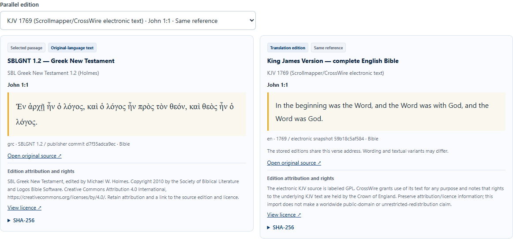

# Original-language library and parallel reading — 9 November 2026

The updated Pinokio application imported the verified UXLC 2.6 Hebrew Bible
(23,213 passages across two non-overlapping selections), SBL Greek New Testament
1.2 (7,939 verses) and Tanzil Uthmani 1.1 Arabic Quran (6,236 ayat). The local
library retained its three English editions and two existing conversations,
bringing the stored total to 80,578 passages. Corpus bytes and credentials
remain outside Git.

| Check | Observed result |
| --- | --- |
| Original text and published translations | Genesis 1:1 in UXLC/JPS, John 1:1 in SBLGNT/KJV, and Quran 1:1 in Tanzil/Pickthall all opened in the real Chrome reader |
| Reading direction and layout | Hebrew and Arabic were RTL; Greek was LTR. The English interface remained LTR. The panes were beside one another at desktop width and stacked at mobile width |
| Earlier saved citations | Genesis 50:1 and Quran 17:23 in the existing conversation retained their cited English snapshot and opened the appropriate Hebrew/Arabic companion |
| New live chat citations | Mistral Large 4.0 answered a Dutch wording question about John 1:1 with both SBLGNT and KJV citations. Both returned texts and edition snapshot hashes matched the stored passages |
| Hebrew numbering | English Genesis 31:55 resolved to Hebrew Genesis 32:1 and carried a mapped-reference label |
| Greek variants | KJV Acts 8:37 had no fabricated Greek counterpart in SBLGNT; `Johannes 1:1` resolved to `John 1:1` |
| Source search and rights | Original-script search worked with the native PostgreSQL `C` locale. Arabic matches remained local and were excluded by the cloud retrieval filter |
| Backend verification | 160 tests passed against the native PostgreSQL test setup, including alignment, unchanged source snapshots and both directions of chat evidence pairing. Ruff passed |
| Frontend verification | 18 unit tests, lint, TypeScript, production build and all three Chrome contract workflows passed |

The reader keeps the original wording, with named editions and their available
source and licence links. A verse mapping establishes a comparable reference;
it does not establish an identical textual tradition or a word-for-word match.
Uncertain parallels are available for manual comparison and do not enter the
model's evidence. These practical checks do not validate interpretation quality.

See [original-text sources](original-text-sources.md) and [parallel reading](parallel-reading.md)
for publisher references, snapshot checks and alignment limits.
