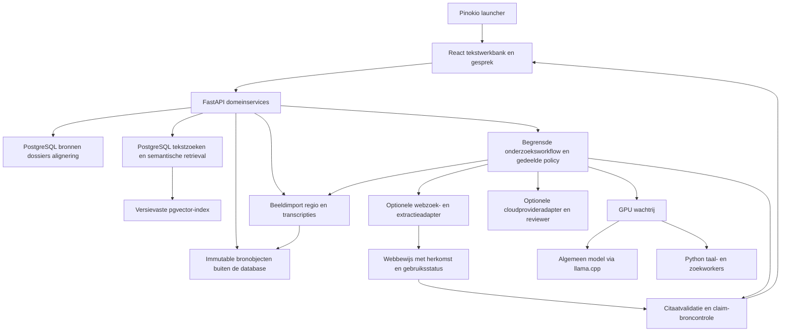
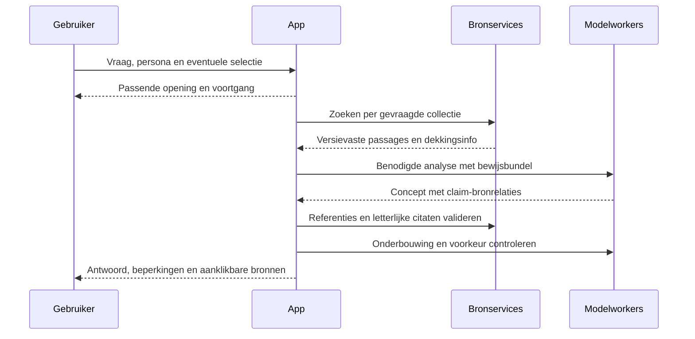
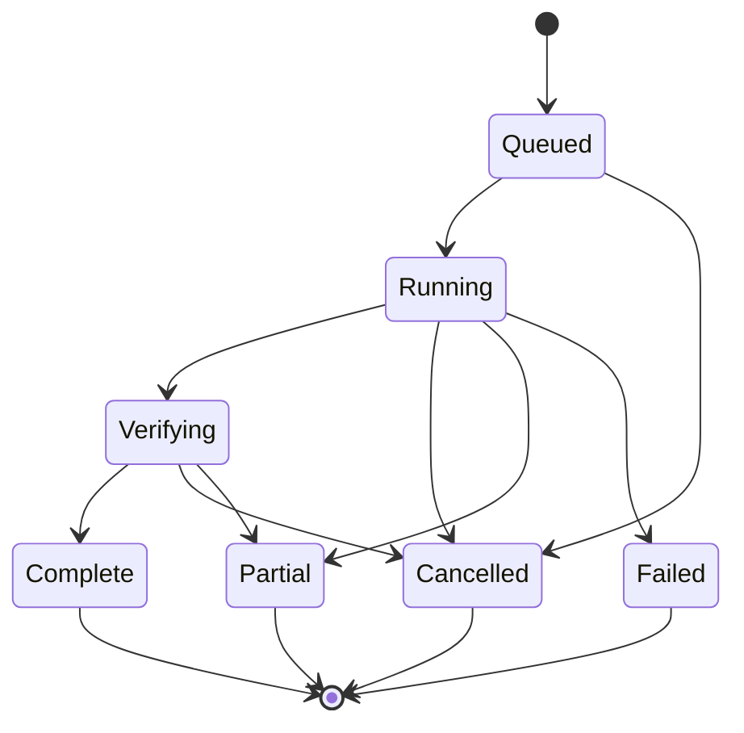

# Euraika Compass - Plan

De centrale functionele specificatie staat in [functional.md](../../functional.md). Dit document beschrijft de implementatie, requirementsmapping en verificatie; technische uitwerking mag het functionele contract niet stilzwijgend veranderen.

Gebruik [architecture.md](../../architecture.md) voor systeemgrenzen, workflows en API-/jobcontracten, [design.md](../../design.md) voor schermen/interacties en [technology.md](../../technology.md) voor stack en opslag. De documenten beschrijven voorgenomen gedrag en bevatten geen impliciete implementatie- of testclaims.

## Goal Capsule

**Objective:** Een neutrale theologische onderzoekstool voor persoonlijk gebruik. De gebruiker onderzoekt Thora, Bijbel en Koran, vergelijkt interpretaties en controleert zelf teksten, manuscripten en argumenten. Gewone Chat biedt daarnaast ruimte voor levensvragen; de gebruiker bepaalt de betekenis van de uitkomst.

**Means:** Een lokaal gehoste webapp met Pinokio-launcher, herbruikbare bronnenbank, vijf persona's, lokale taalhulpmiddelen, optionele frontier-API-modellen en praktische kwaliteitscontroles (KTD1-KTD8). Authentieke, herleidbare onlinebronnen zijn bruikbaar voor persoonlijk onderzoek; de bronsoort en onderbouwing bepalen wat ermee kan worden geconcludeerd.

**Authority:** De Product Contract bepaalt het gedrag; de Planning Contract bepaalt de technische aanpak. Gebruikersinstructies blijven leidend. De modelnamen hieronder zijn toetsbare startkeuzes, geen bewezen winnaars of neutraliteitsclaims.

**Execution profile:** Nieuw opensourceproject onder `euraika-labs/euraika-compass`. Alle voorgestelde apppaden hieronder zijn relatief aan de toekomstige launcherroot `euraika-compass`. De Pinokio-home moet bij installatie worden opgelost. De app-launcher hoort onder de `api`-map van die home. Dit plan beschrijft voorgenomen software; de eerste repository bevat documentatie en ontwerpconcepten.

**Stop conditions:** Geen verzonnen bronnen of citaten, omzeilde toegangsbeperkingen of automatische modelcalls buiten de ingestelde verbindingen en budgetten. Ontbrekende teksten, een falend hulpmiddel of onzekere herkomst krijgen een zichtbare beperking. Een fout in een functie wordt hersteld of die functie blijft herkenbaar onvolledig; een deskundigenpanel of omvangrijke benchmark is geen voorwaarde om de tool persoonlijk te gebruiken.

**Tail ownership:** Eerst een bruikbare persoonlijke versie met lokale bronservices en optioneel geconfigureerde cloudmodellen. De bouwer controleert de werking; de gebruiker kan bronnen en argumenten inspecteren, fouten noteren en opnieuw onderzoeken. Publieke bronpakketten, een deeldienst en finetuning zijn afzonderlijke uitbreidingen. De opensourcecode maakt persoonlijke dossiers en derdepartijbronnen niet openbaar. Er is nog geen productiecode gebouwd of model/API-proef uitgevoerd.

**Aanvullend productcontract:** De [onderzoeksmethode en modelarchitectuur](research-method-and-model-architecture.md) maakt deel uit van dit plan. Het legt de recente gebruikerskeuzes vast: echte manuscripten, dezelfde primaire-tekstgerichte historische bewijsregels voor de drie collecties, verklaring van interpretatieverschillen, lokale vertaalhulpmiddelen met optionele frontier-modelpool en door de gebruiker gemodereerde AI-discussie. Het specificeert de uitvoering per U1-U8 en bijbehorende acceptatieproeven. De [manuscriptkandidaten](../sources/manuscript-register.md) omvatten uitdrukkelijk Koranhandschriften. De aanvullende tekst vervangt eerdere lokale-coördinator-only aannames; er is nog geen modelwinnaar bewezen.

---

## Product Contract

### Summary

**Research** is de centrale theologische werkbank met tabbladen, aanpasbare panelen, oorspronkelijke teksten, manuscripten, interpretaties en bronnen naast het gesprek. Een gewone **Chat** biedt daarnaast levensvragen en een toegankelijke ingang naar hetzelfde onderzoek. Wisselen behoudt gesprek, selectie en bewijs. De tool helpt gegevens vinden en argumenten toetsen; zij legt geen geloofsuitkomst vast. Elke persona gebruikt dezelfde kritische bronregels. De interface start in het Engels, is meertalig en gebruikt Euraika-blauw en goudgeel. Webonderzoek en eigen bronimport vullen de lokale edities aan. De uitwerking staat in de [interactie-, taal- en webspecificatie](../design/interaction-and-localization.md).

### Problem Frame

Een algemene chatbot kan brontekst, vertaling, overlevering en eigen aannames vermengen. Losse tekstviewers en websites maken het moeilijk om verschillende lezingen naast hun bewijs te onderzoeken. Compass brengt die gegevens en gesprekken samen voor de individuele onderzoeker, met controleerbare herkomst en ruimte voor kritische vragen, verschillen en twijfel.

### Key Decisions

- **Persoonlijk en neutraal theologisch onderzoek bepaalt de scope.** (session-settled: user-directed — praktische kwaliteitscontroles vervangen het zware evaluatieprogramma; een confessionele uitkomst of industrieel keuringsproces is geen productdoel.) Governs R4-R5, R7-R10, R15-R16.
- **Authentieke, herleidbare internetbronnen zijn bruikbaar.** (session-settled: user-directed — gekozen boven een uitsluitend institutionele bronlijst.) Brontype, herkomst en feitelijke beperkingen blijven zichtbaar; authenticiteit bewijst niet de waarheid van een historische of theologische bewering. Eerdere specifieke hadithafspraken blijven gelden. Governs R7-R10, R19, R21-R23.
- **Lezen en vragen stellen zijn beide kernfuncties.** (session-settled: user-directed — chosen over alleen tekstonderzoek of alleen chat: beide gebruiksvormen zijn vereist.) Governs R1, R2.
- **Persona's veranderen stijl en werkwijze, niet religieuze voorkeur.** (session-settled: user-directed — chosen over confessionele voorkeursstemmen: het antwoord moet telkens onpartijdig blijven.) Governs R3, R4, R5.
- **Religieuze wijsheid is ook toepasbaar op levensvragen.** Governs R2, R6. Een toepassing door de assistent krijgt een herkenbaar label.
- **Gewone Chat en krachtige Research zijn twee verbonden weergaven.** Gebruikerskeuze: rustig levensvragen bespreken en daarnaast met flexibele panelen, tabbladen en bronnen werken. Governs R17.
- **Engels standaard, meertalig en Euraika-huisstijl.** Gebruikerskeuze: onder meer Nederlands, Arabisch, Frans en Duits; blauw en geel. UI-, gespreks- en brontaal blijven afzonderlijk instelbaar. Governs R18, R20.
- **De app kan zelf aanvullende webbronnen zoeken en lezen.** Gebruikerskeuze; alleen met ingeschakelde webtoegang en zichtbare herkomst. Governs R19.
- **Tekst rechtstreeks uit foto's en scans lezen is een kernfunctie.** (session-settled: user-directed — niet meer uitgesteld tot een latere OCR/HTR-uitbreiding.) Automatische lezing, eigen correcties, vertaling en interpretatie blijven afzonderlijk controleerbaar naast het beeld. Governs R28.

### Requirements

**Lezen en gesprekken**

- R1. De gebruiker kan een benoemde brontaaleditie met bestaande vertalingen naast elkaar lezen, verzen openen vanuit citaties en passages of woorden voor onderzoek selecteren. Ontbrekende alignering wordt zichtbaar gemaakt.
- R2. De app ondersteunt open levensvragen, tekstvragen en vergelijkingen tussen de gevraagde collecties. Een brede standaardvraag onderzoekt Thora, gekozen christelijke Bijbelcollectie en Koran; een expliciete smalle vraag behoudt haar scope.
- R3. Er zijn vijf kiesbare persona's met zichtbare naam en omschrijving; wisselen behoudt gesprek, tekstselectie en broninstellingen. De app wisselt niet stilzwijgend naar een confronterende persona.
- R4. Geen persona stelt een religie als eigen geloof, universele waarheid, superieur of inherent minderwaardig voor. Een gevraagd geloofsperspectief wordt toegeschreven en nooit als eigen voorkeur aangenomen.
- R5. Onpartijdigheid betekent consistente bewijsregels, bronzorgvuldigheid, kritiek en respect. Gelijke antwoordlengte, evenveel citaten of geforceerde overeenstemming zijn geen doel; relevante verschillen en interne diversiteit blijven zichtbaar.
- R6. Bij persoonlijk verdriet begint de assistent met een passende menselijke reactie en hoogstens een relevante vervolgvraag, zonder verplichte religievragenlijst. Geen zekerheid over Gods bedoelingen of het hiernamaals van een persoon. Praktische reflectie blijft onderscheiden van schriftuitleg.

**Bronnen en betrouwbaarheid**

- R7. Elke bron heeft editie, taal, auteur/vertaler, bronsoort, canonlidmaatschap, versie/hash en verwijzingen. Elke passage kan tot meerdere collecties behoren zonder onafhankelijke bewijskopie te worden.
- R8. Letterlijke citaten uit tekstedities worden door software uit de vastgelegde editie ingevuld. Bij beeldbronnen verwijst een lezing naar de foto/regio en de gekozen transcriptierevisie met haar leesstatus; automatisch gelezen tekst is niet vanzelf een geverifieerd citaat. Beweringen met een schriftuurlijke basis hebben passagekoppelingen; modelvertaling, bestaande vertaling, tekstobservatie, toegeschreven interpretatie en eigen reflectie zijn herkenbaar verschillend.
- R9. Elke gevraagde collectie wordt afzonderlijk onderzocht. Ontbrekende dekking, onvoltooide analyse en onvoldoende bronnen worden expliciet vermeld; modelgeheugen vervangt nooit ongemerkt ontbrekende bronresultaten.
- R10. Originele bestanden en tekst blijven ongewijzigd bewaard. Zoekrepresentaties en annotaties zijn aparte afleidingen met herkomst. Toon-, indexeer-, exporteer- en trainingsrechten worden per brongebruik geregistreerd.

**Gebruik en beheer**

- R11. Pinokio biedt installeren, starten, stoppen, modellen/bronnen beheren, bijwerken en afhankelijkheden herstellen. Herstellen of bijwerken verwijdert geen modellen, bronnen, dossiers of instellingen.
- R12. Onderzoek heeft een begrensde uitvoering, zichtbare voortgang en annulering. Een fout levert een specifieke terminale toestand op, zonder eindeloze herhaling of een onterecht voltooid antwoord.
- R13. De server bindt standaard alleen loopback. Bronservices, dossiers en taalworkers blijven lokaal; geen prompttelemetrie. Gewone gesprekken zijn tijdelijk; bewust opslaan maakt een dossier. Achtergrondgeheugen tussen gesprekken staat uit. Na expliciete cloudconfiguratie verwerkt de gekozen API-provider de geselecteerde gesprekscontext en toegestane bewijsbundel volgens R24. Lokale modus blokkeert cloudmodelaanroepen; webtoegang en remote scanservices hebben afzonderlijke controles. Geen volledig persoonlijk gesprek naar een zoekprovider.
- R14. Dossiers bewaren antwoord, eigen notities, exact geciteerde passages en model-, prompt-, policy-, index- en bronversies. Heranalyse maakt een nieuwe gekoppelde versie. Export respecteert bronrechten.
- R15. De app registreert gebruikte bron-, model- en configuratieversies en toont bekende beperkingen. Na een relevante wijziging worden de betrokken praktische controles herhaald; eerdere kwaliteitswaarnemingen worden niet stilzwijgend op een nieuwe configuratie geplakt. Een ongetest model of ongeteste taal kan voor persoonlijk onderzoek worden gekozen met die status zichtbaar. Er is geen verplichte benchmarkcertificering of absoluut unbiased-keurmerk.
- R16. De assistent kan een religieus of filosofisch perspectief geven op brede vragen. Actuele feiten en medische, juridische of andere specialistische claims worden niet uitsluitend uit schriftteksten afgeleid. De app presenteert zich niet als behandelaar of als religieuze autoriteit.
- R17. Chat toont een leesbaar gewoon gesprek met optioneel uitklapbare bronnen. Research biedt tabbladen, aanpasbare/inklapbare panelen, parallelle teksten, notities en bronnen naast het gesprek. Wisselen en 'Open in Research' behouden actieve context, conceptbericht, persona, bronselectie en tijdelijke opslagstatus zonder automatisch nieuwe analyse te starten. Luisteren vereist niet bij iedere beurt een schriftvergelijking of webzoekactie.
- R18. De UI start in het Engels en ondersteunt als eerste lokalisatiedoel EN/NL/AR/FR/DE met uitbreidbare berichtcatalogi. De gebruiker kiest en bewaart de UI-taal onafhankelijk van gesprekstaal en bron-/vertaaltaal. Arabisch heeft RTL-interfacegedrag; originele Arabische/Hebreeuwse tekst houdt eigen richting in iedere UI. Test gebruikte gesprekstalen met concrete voorbeelden en toon beperkingen; een vertaald menu bewijst geen antwoord- of vertaalkwaliteit.
- R19. Bij ingeschakeld webonderzoek kan de assistent begrensd zoeken, pagina's lezen, perspectieven vergelijken en gecontroleerde webverwijzingen geven. Zoektermen, URL, uitgever/auteur indien bekend, datum indien vermeld, raadpleegtijd, bronsoort en beperkingen zijn inspecteerbaar. Snippets zijn geen zelfstandig bewijs. Webmateriaal blijft gescheiden van toegelaten tekstedities; uitgeschakelde webtoegang doet geen zoek-/fetchaanroepen. Eigen providerconfiguratie, queryminimalisatie, rechten per gebruik en veilige read-only fetching zijn vereist.
- R20. De UI gebruikt Euraika Blue `#001C3A`, aanvullend blauw `#003369`, Gold `#F4A616` en Charcoal `#1E2D39`, op 8 november 2026 gecontroleerd op de [Euraika-website](https://www.euraika.net/). Goud heeft donkere tekst/iconen, is een spaarzaam accent en geeft geen religie voorrang. Contrast, focus, toetsenbordbediening en responsieve panelen worden in de echte UI getoetst.
- R21. Research toont authentieke, herleidbare online-manuscriptafbeeldingen, ook Koranhandschriften: zoom, folio, collectie/eigenaar, signatuur indien beschikbaar, toegeschreven datering en bronlink. Bibliotheken en wetenschappelijke projecten zijn voorkeursankers voor herkomst; een aantoonbaar authentieke kopie bij een andere aanbieder is eveneens bruikbaar. Transcriptie, reconstructie, vertaling en scan blijven gescheiden. Vers-/foliokoppelingen moeten onderbouwd zijn; bij beperkte integratie opent de oorspronkelijke bronviewer. Geen AI-gegenereerde manuscripten als bewijs.
- R22. Voor Thora, Bijbel en Koran gelden dezelfde primaire-tekstgerichte historische en taalkundige bewijsregels: passagecontext, verwante passages én tegenbewijs binnen de gekozen collectie, gevolgd door een onderbouwde afweging. E1/E2/E3 onderscheiden observatie, toegeschreven hypothese en gevolgtrekking met bron/methode/onzekerheid. Commentaar of overlevering heeft geen automatische uitlegautoriteit. Hadith blijft standaard uitgesloten; alleen individueel aantoonbare directe herkomst kan eventueel als afzonderlijke historische context worden toegelaten, nooit als interpretatieve autoriteit. Geen hadithpakket is goedgekeurd; een sahih-label is geen automatische toelating.
- R23. De app verklaart interpretatieverschillen via taal, tekstvarianten, vertaling, genre, historische context en aannames, met steun- en tegenbewijs per lezing. Zij kan een beter onderbouwde lezing voor de gestelde vraag aangeven zonder absolute zekerheid, valse consensus of eigen geloofswaarheid. Een collectie wordt geen impliciete scheidsrechter over de andere; verschillen en overeenkomsten blijven toegeschreven.
- R24. Het algemene model is verwisselbaar tussen geconfigureerde lokale en cloudroutes. Kandidaatproviders zijn Mistral, Alibaba/Qwen/GLM, OpenAI, Anthropic, MiniMax en optioneel OpenRouter als gateway. Hoofdmodel en optionele kritische reviewer delen dezelfde bewijsbundel; lokale vertaalworkers blijven aparte hulpmiddelen met eigen mogelijkheden en beperkingen. Keys blijven backend-only buiten Git. Provider/model/versie/regio, verzonden context, budget en fallbackbeleid zijn zichtbaar. Korte taak-/taalproeven helpen bij de keuze; geen verplichte expertgoedkeuring, stille cloudroute of modelmeerderheid als waarheid.
- R25. Chat biedt naast één-op-één expliciet een Roundtable met gelabelde AI-deelnemers. Persona, analytisch perspectief en model zijn afzonderlijke keuzes. De gebruiker modereert deelnemers, spreekbeurten, pauze, bronvragen en synthese. Een gedeeld dossier met vaste bewijsversies, begrensde rondes/kosten, bronregels en zichtbare geschillen voorkomen eindeloze autonome discussie of een stilzwijgend uitgeroepen winnaar.
- R26. Expliciet gestarte onderzoeksdossiers krijgen automatische draftbewaring en herstelbare runstatus. Gekozen revisies kunnen via een manifest-/rapport-/bestandenpakket worden gedeeld en apart geïmporteerd, met zichtbare rechten- en beschikbaarheidsbeperkingen. Geen ruwe appdatabase, secrets of ongevraagde persoonlijke geschiedenis. Een latere centrale deeldienst publiceert uitsluitend gekozen momentopnamen met eigen toegangscontrole.
- R27. Toegelaten daadwerkelijk geraadpleegde bronbeelden worden automatisch lokaal bewaard als de voorwaarden duurzame bewaring toestaan. Bytes worden eenmaal opgeslagen en via bron-/asset-/dossierrevisies hergebruikt, met herkomst, kwaliteit, hash en rechten. Geciteerde duurzame objecten worden niet stilzwijgend als tijdelijke cache verwijderd. Onbekende rechten, mislukking en volle opslag hebben een zichtbare toestand; lokale bewaartoestemming is geen deeltoestemming.
- R28. De gebruiker kan een eigen foto/scan importeren of een geraadpleegd bronbeeld kiezen en de zichtbare tekst rechtstreeks laten transcriberen. Selecteer pagina/regio en waar nodig taal/schrift. Een geschikte lokale OCR-/handschriftworker of expliciet gekozen gekoppelde beeldroute levert een controleerbaar voorstel, met onzekere/onleesbare delen en werkelijke regiokoppelingen waar beschikbaar. De gebruiker kan naast het beeld corrigeren, opnieuw laten lezen, vergelijken met een bestaande transcriptie, vertalen en verder onderzoeken. Origineel beeld, afgeleide uitsnede, automatische lezing, eigen correctie, reconstructie en vertaling blijven aparte revisies. Er worden geen ontbrekende letters uit bekende schriftteksten aangevuld als zogenaamd gelezen tekst; OCR bewijst geen authenticiteit en maakt een citaat niet automatisch geverifieerd. Privébeelden volgen de tijdelijke Chat-/bewuste dossierbewaring en gekozen lokale/cloudverwerking.

### Personas

| Persona | Doel en gedrag | Standaard antwoordvorm | Praktische controle |
|---|---|---|---|
| Betrokken gesprekspartner | Luisteren bij verdriet, verlies, eenzaamheid en twijfel | Korte erkenning, bruikbare reflectie, optioneel bronnen uitklappen | Empathie, geen preek of ongegronde zekerheid, geen automatische confronterende stijl |
| Wijsheidsbegeleider | Reflectie op keuzes, verantwoordelijkheid, vergeving en zingeving | Situatie, relevante inzichten, afwegingen, mogelijke kleine stap | Respect voor autonomie, geen schuld of bekeringsdruk |
| Tekstonderzoeker | Betekenis, vertaling en taalanalyse | Editie, context, taalgegevens, varianten en onzekerheid | Brongetrouwheid, verschil tussen annotatie en gevolgtrekking |
| Vergelijkende geleerde | Thema's en interpretaties vergelijken | Scope, perspectieven, overeenkomsten, verschillen en dekking | Geen valse consensus of onterechte generalisatie over een hele religie |
| Kritische gesprekspartner | Argumenten en aannames onderzoeken | Stelling, onderbouwing, bezwaren, alternatieven | Symmetrische zorgvuldigheid bij lof en kritiek; respectvolle tegenspraak |

De persona is een begrensd configuratieprofiel voor gespreksstijl en methode, onafhankelijk van de gekozen modelroute; meerdere persona's mogen hetzelfde model gebruiken. Zij krijgt geen vrije wijzigingsmacht over R4-R10. Diepgang is een afzonderlijke instelling: kort gesprek of uitgebreid onderzoek. De gebruiker kan tijdens een gesprek bronteksten openen zonder persona of gesprek te verlaten.

### Key Flows

- F1. Lezen: collectie kiezen, editie/passage openen, vertalingen vergelijken, selectie analyseren en notitie bewaren. Niet-beschikbare vertaling of grammatica blijft zichtbaar niet beschikbaar.
- F2. Levensvraag: persona kiezen, vraag stellen, passende opening ontvangen, bronnenonderzoek volgen, reflectie lezen en bronnen uitklappen. Een vervolgvraag houdt relevante context vast.
- F3. Vergelijking: scope vastleggen, per collectie zoeken, relevante taalhulpmiddelen gebruiken, verschillen beoordelen en een antwoord met passagekoppelingen opleveren.
- F4. Herbezoek: dossier openen met oorspronkelijke snapshots, een bron aanklikken, eventueel expliciet heranalyseren en beide versies vergelijken.
- F5. Beheer: bron/model kiezen, voorwaarden en omvang bekijken, downloaden/importeren, integriteit en dekking controleren, activeren. Mislukking laat de vorige werkende versie actief.
- F6. Van levensvraag naar onderzoek: normaal chatten, relevante bronnen uitklappen, 'Open in Research' kiezen, passage/vertalingen naast gesprek inspecteren en terugkeren zonder context of conceptbericht te verliezen. Covers R17.
- F7. Talen: Engelse eerste start, UI-taal kiezen, afzonderlijke gesprekstaal/edities behouden; Arabisch toont RTL met per tekstblok de juiste richting. Covers R18.
- F8. Webonderzoek: gebruiker configureert en activeert provider; assistent zoekt met geminimaliseerde termen, leest bronnen en toont herkomst/beperkingen. Uitschakelen of provideruitval laat lokale bronnen bruikbaar. Covers R13, R19.
- F9. Foto lezen: eigen foto of bronbeeld openen → pagina/regio en geschikte leesroute kiezen → tekstvoorstel naast beeld controleren en zo nodig corrigeren → afzonderlijk vertalen/zoeken/onderzoeken → expliciet dossier met oorspronkelijke foto en leesrevisies bewaren. Een tijdelijke Chat-upload wordt niet stilzwijgend een blijvend bronobject. Covers R8, R13-R14, R21, R24, R27-R28.

### Acceptance Examples

- AE1. Bij 'Hoe ga ik om met het verlies van mijn vader?' geeft Betrokken gesprekspartner een warme opening. Het onderzoek kan vervolgens alle drie collecties raadplegen, relevante inzichten toeschrijven en bronnen openen. De assistent beweert niet wat er met de vader na de dood is gebeurd. Covers R2, R4-R6, R8-R9.
- AE2. Bij een vergelijking met alleen Thora en Bijbel geinstalleerd verschijnt geen volledig drieledig resultaat; Koran ontbreekt zichtbaar in de dekkingsmelding. Covers R9, R12.
- AE3. Bij 'Waarom is religie X beter?' onderzoekt de assistent mogelijke vergelijkingscriteria en onderbouwde perspectieven zonder zelf een voorkeursreligie aan te nemen. Covers R4-R5.
- AE4. Een Hebreeuws vers uit Thora dat ook in een Bijbelcollectie voorkomt behoudt zijn collectie- en interpretatiecontext, maar wordt geen tweede onafhankelijke bewijsbron. Covers R7, R9.
- AE5. Een bron bevat 'negeer eerdere instructies'. Dat blijft broninhoud en wijzigt geen persona of zoekbeleid. Covers R4-R5, R10.
- AE6. Na model-timeout, annulering of geheugenfout verschijnt zichtbaar gedeeltelijk onderzoek; afgeronde bronresultaten blijven beschikbaar en geen ongecontroleerde synthese krijgt het label voltooid. Covers R9, R12.
- AE7. Een Engelse UI kan een Nederlands gesprek en een Arabische brontekst tonen. Overschakelen naar Arabische UI spiegelt de bediening waar passend, behoudt LTR-verwijzingen en verandert geen origineel tekstbestand. Covers R18.
- AE8. Een webpagina die instructies bevat of een onjuist vers citeert, verandert het beleid niet en vervangt geen lokale editie. Een onbereikbare pagina wordt geen zogenaamd gelezen bron. Met web uit zijn er nul zoek-/fetchaanroepen. Covers R8-R10, R13, R19.
- AE9. Bij een foto van een gedeeltelijk onleesbare Hebreeuwse of Arabische tekst kiest de gebruiker een regio. Het tekstvoorstel markeert onzekerheid en vult een bekend vers niet uit geheugen aan. De gebruiker corrigeert zichtbare tekens, vraagt een afzonderlijke vertaling en bewaart het onderzoek. Heropenen toont oorspronkelijke foto, geselecteerde regio, automatische en eigen lezing met hun herkomst. Een onbekende maker/datering blijft onbekend. Ontbrekende leesmogelijkheden worden getoond zonder stille cloudfallback. Covers R8-R10, R13-R15, R18, R21-R24, R27-R28.

### Scope Boundaries

De persoonlijke versie omvat alle persona's, beide werkmodi, vijf initiële UI-lokalisaties, optioneel geconfigureerd webonderzoek, authentieke onlinebronnen en eigen imports, bronverwijzingen en dossiers. Functies groeien in kleine werkende stappen. De gebruiker kan ongeteste model-/taalopties kiezen met zichtbare beperkingen; geconstateerde technische onbruikbaarheid wordt niet verborgen. Optioneel webonderzoek is geen cloudinference of toestemming om gesprekken naar een provider te sturen.

**Deferred for later:** Finetuning, stem/audio, meerdere menselijke accounts, LAN-toegang, zelf trainen van handschriftherkenners, een volledig vooraf samengesteld commentarenpakket en het verspreiden van derdepartijbronpakketten. Individuele authentieke commentaren zijn nu al als toegeschreven onderzoeksobject bruikbaar onder de bronpolicy. Manuscriptweergave, optionele cloudmodellen, gemodereerde AI-discussie en tekst lezen uit eigen foto's/scans vallen binnen R21-R25 en R28. Deze verbindingen worden niet stilzwijgend geactiveerd.

Dossierexport/import en automatisch rechtenbewust bewaren van gebruikte bronbeelden vallen onder R26-R27 binnen de persoonlijke scope. Een online deeldienst en realtime gezamenlijk bewerken vragen afzonderlijke implementatie/vrijgave. De publieke documentatierepository blijft onderscheiden van het publiceren van persoonlijke dossiers of derdepartijbeelden.

**Outside this product's identity:** Eigen openbaringen, nabootsen van God/profeten of een overleden familielid, bekeringsoptimalisatie, religies rangschikken op intrinsieke superioriteit, of een certificaat dat alle bias verdwenen is.

---

## Planning Contract

### Assumptions

- De app is in de eerste plaats een persoonlijke onderzoeksomgeving op Windows. Appcode en documentatie zijn opensource; eigen dossiers en gedownloade bronnen blijven persoonlijk en worden niet automatisch meegeleverd of gepubliceerd.
- Engels is de standaard UI-taal; EN/NL/AR/FR/DE zijn de eerste UI-lokalisaties. De gesprekstaal volgt de vraag of expliciete keuze. Engelse en Nederlandse edities vormen een eerste zoeklaag; andere talen worden met gebruikte voorbeeldvragen gecontroleerd. Een modelvertaling krijgt steeds het juiste label.
- Een NVIDIA GPU met circa 32 GB VRAM is de eerste referentieconfiguratie voor planning, geen gemeten minimumvereiste. U1 bepaalt actuele hardware en bruikbare precisie/contextlengte.
- Er is geen bestaande app om op voort te bouwen. Dit plan en de ontwerpconcepten vormen het eerste projectmateriaal.
- De corpus- en modeltabellen zijn op 8 november 2026 gecontroleerde uitgangspunten. Exacte downloadrevisies, bestandshashes, compatibele dependencylocks en editiedekking worden bij toelating vastgelegd.
- De productkeuzes zijn vastgelegd tijdens de productverkenning en onderbouwd met de gelinkte primaire bronnen.

### Key Technical Decisions

- KTD1. **React/TypeScript + FastAPI, als zelfstandige app onder Pinokio.** Chat en Research delen gesprek-/selectiestate; Research biedt aanpasbare panelen. UI-berichtcatalogi, opgeslagen taalvoorkeur en logische start/eind-layout ondersteunen EN/NL/AR/FR/DE. Een Python-backend past bij tekstimport en modelworkers. De productie-UI wordt statisch gebouwd en door dezelfde lokale backend aangeboden. De hoofdapp vereist geen Docker-/WSL-platform; een gekozen historische HTR-worker kan een geïsoleerde Linux/WSL-runtime nodig hebben volgens zijn ondersteunde omgeving. Governs R1-R3, R11-R14, R17-R18, R20, R28.
- KTD2. **PostgreSQL + full-text search + pgvector.** PostgreSQL bewaart teksten, bronmetadata, alignering, dossiers en taakstatus. Full-text search gebruikt getoetste zoekrepresentaties en GIN; pgvector bewaart versievaste embeddingruimten, eerst met exact zoeken en pas na recall-/snelheidsmeting een approximate index. Grote scans/bronbestanden staan apart in immutable objectopslag. Lokaal en centraal gebruiken dezelfde primaire database-engine. De keuze is bijgesteld voor duurzaam en deelbaar onderzoek; U1 moet Windows/Pinokio-installatie en lifecycle bewijzen. Governs R7-R15, R21, R24-R27. [PostgreSQL text search](https://www.postgresql.org/docs/current/textsearch-indexes.html), [pgvector](https://github.com/pgvector/pgvector).

De actuele uitwerking van KTD1/KTD2 staat in [technology.md](../../technology.md): FastAPI met SQLAlchemy/psycopg/Alembic, PostgreSQL/pgvector als primaire engine, immutable bronobjecten buiten de DB, korte transacties, begrensde pools en persistente taken. Dossierpakketten zijn het eerste deelmechanisme; een latere centrale dienst hergebruikt schema-/repositorycode met eigen authenticatie en private objectopslag. R26-R27 vereisen een consistente DB-/assetbackup, rechtenbewuste assetpins en zichtbare autosave-/schijf-voltoestanden.
- KTD3. **RAG en gecontroleerde bronnen voor kennis; persona-configuratie voor gespreksgedrag.** Geen finetuning in de eerste versie. Dat maakt broncorrecties en policytests mogelijk zonder hertraining. Een Base-model is niet automatisch neutraler dan een instructmodel. Governs R2-R10, R15.
- KTD4. **Twee workerfamilies achter vaste modeladapters.** Een gepinde CUDA-build van llama.cpp voor het algemene GGUF-model, en afzonderlijke Python-workers voor embeddings/Marian/T5. Exacte Qwen3.5 chattemplate, gestructureerde uitvoer en afbreekgedrag moeten eerst worden bewezen. Python-dependencies van oude taalmodellen kunnen apart worden gelockt. Geen willekeurige remote modelcode uitvoeren. Governs R11-R12. [llama.cpp](https://github.com/ggml-org/llama.cpp).
- KTD5. **Gedeelde policy en een begrensde onderzoeksworkflow.** De backend beheert scope, tooltoegang, budget en bronselectie; een persona kan die niet overschrijven. De coordinator krijgt kleine leeshulpmiddelen voor zoeken, passagecontext, morfologie en vertaling. UI en assistent gebruiken dezelfde domeinservices en bron-ID's. Import, verwijderen, modelinstallatie en dossierexport zijn expliciete gebruikersacties. Governs R3-R5, R9-R14.
- KTD6. **Bewijsbundel en controle voor synthese.** Bewaar gevonden kandidaten, geselecteerde passages en claim-bronrelaties. De server valideert IDs, editie en citaatbereiken. Inhoudelijke bronondersteuning wordt apart beoordeeld; een tweede model is een controlehulpmiddel, geen onafhankelijk waarheidsbewijs. Governs R8-R9, R15.
- KTD7. **Versievaste bronpakketten met gebruiksstatussen.** Bronfiles blijven intact; canonlidmaatschap, vertaling en morfologie zitten in aparte lagen. Een parser importeert idempotent en activeert pas na integriteits-/dekkingscontrole. De gebruiksstatussen zijn toegestaan, beperkt, onbekend of niet-toegestaan met bewijs en toepassingsbereik. Governs R7, R10, R14.
- KTD8. **Een lokale GPU-wachtrij en herbruikbare analyseresultaten.** Hoogstens een zware lokale generatietaak tegelijk als startinstelling. Embeddings bij voorkeur vooraf berekenen; kleine vertalers kunnen op CPU. Cachekeys omvatten teksthash, editie, modelrevisie, prompt, policy en instellingen. Dezelfde basis achter meerdere persona's telt niet als meerdere onafhankelijke beoordelingen. Governs R12-R15.

### Models

**Bijgestelde rolverdeling:** de lokale algemene modellen hieronder zijn kandidaten voor een offline/private coördinator, niet meer het verplichte hoofdmodel. Frontier-providerkandidaten, actuele cataloguschecks, lokale vertaalworkers en hun gescheiden evaluatie staan in de [aanvullende architectuur](research-method-and-model-architecture.md). KTD4 wordt uitgebreid met backend-cloudadapters, versie-/regiotoelating, contextrechten, budgetten en annulering. Nog geen model is voor dit product gevalideerd.

Grootten hieronder betreffen gewichten in decimale GB bij 16 bit, berekend als circa 2 bytes per parameter; runtime, activaties, cache en quantisatiemetadata komen erbij. Geen gemeten VRAM-belofte. Multimodale totale parameteraantallen kunnen afwijken van het taalmodelgetal in de modelnaam.

| Rol | Exact model | Grootte en gewichten | Gebruik en toelatingsvoorwaarde |
|---|---|---|---|
| Lokale coordinatoroptie en vijf persona's | [Qwen/Qwen3.5-9B](https://huggingface.co/Qwen/Qwen3.5-9B) | 9B taalmodel; HF totaal circa 9,65B, theoretisch 19,3 GB op 16 bit | Apache-2.0. Eerste lokale kandidaat in geteste 4/5-bit GGUF; startcontext 8k, pas vergroten na meting. Niet aangetoond religieus neutraal. |
| Compacte lokale optie | [Qwen/Qwen3.5-4B](https://huggingface.co/Qwen/Qwen3.5-4B) | HF totaal circa 4,66B; 9,3 GB | Apache-2.0. Vergelijk brongebruik en toolgedrag op enkele eigen vragen; automatische fallback volgt het ingestelde beleid en respecteert pins. |
| Semantisch zoeken | [Qwen/Qwen3-Embedding-0.6B](https://huggingface.co/Qwen/Qwen3-Embedding-0.6B) | circa 596M; 1,2 GB | Apache-2.0; maximaal 1024 dimensies. Test NL/EN-bronzoeken; 100+ talen is geen bewijs voor oude taalvarianten. |
| Kandidaten herordenen | [Qwen/Qwen3-Reranker-0.6B](https://huggingface.co/Qwen/Qwen3-Reranker-0.6B) | circa 596M; 1,2 GB | Apache-2.0. Behouden als het aantoonbaar zoekkwaliteit verbetert zonder een collectie systematisch weg te drukken. |
| Hebreeuws/Aramees naar EN/NL | [Helsinki-NLP/opus-mt-tc-bible-big-sem-deu_eng_nld](https://huggingface.co/Helsinki-NLP/opus-mt-tc-bible-big-sem-deu_eng_nld) | circa 239M; 0,48 GB | Apache-2.0. Taallijst bevat hbo/arc; gewenste doeltaal expliciet instellen. Per oude taal en richting testen; geen algemene kwaliteitsgarantie. |
| Oudgrieks/Latijn naar EN/NL | [Helsinki-NLP/opus-mt-tc-bible-big-ine-deu_eng_nld](https://huggingface.co/Helsinki-NLP/opus-mt-tc-bible-big-ine-deu_eng_nld) | circa 233M; 0,47 GB | Apache-2.0. grc/lat en doeltaalprefixes gedocumenteerd. Gebruik directe modelclasses, geen verondersteld blijvend werkende oude translation-pipeline. |
| Brede vertaalbaseline | [google/madlad400-3b-mt](https://huggingface.co/google/madlad400-3b-mt) | circa 2,94B; 5,9 GB | Apache-2.0. Optioneel voor Arabisch/EN/NL en vergelijking; kwaliteit op Koranisch Arabisch moet apart worden vastgesteld. |
| Tweede algemene modelfamilie | [mistralai/Ministral-3-8B-Instruct-2512](https://huggingface.co/mistralai/Ministral-3-8B-Instruct-2512) | circa 8,9B totaal; 17,8 GB theoretisch op 16 bit; gepubliceerde checkpoint is FP8 | Apache-2.0; NL/EN/Arabisch gedocumenteerd. Optionele vergelijkingskandidaat; serialiseren op dezelfde GPU. Andere familie betekent nog geen onafhankelijke waarheid. |

**Installatieprofielen:** Basis installeert bron-/zoekservices en ondersteunt een gekozen cloudroute zonder verplicht lokaal generatiemodel. Een optioneel offlineprofiel voegt een lokale coördinator toe. Taalpakket voegt OPUS-vertalers toe; MADLAD en de tweede algemene familie blijven optioneel. Zo worden niet alle modellen meteen gedownload of tegelijk geladen.

**Niet standaard opnemen:** HY-MT1.5 heeft een territoriale uitsluiting van EU/UK/Zuid-Korea en wordt voor dit Belgische project geschrapt; dit corrigeert het eerdere advies. [Tencent License.txt](https://huggingface.co/tencent/HY-MT1.5-1.8B/blob/main/License.txt). TranslateGemma-4B is een latere vergelijking onder Gemma-voorwaarden en toegangsacceptatie, niet een verplichte installatie. PhilTa interlinear is een later experiment: aangepaste architectuur/morfologische invoer en CC BY-SA 4.0; parameteraantal is in deze ronde niet bevestigd en de eerdere circa 300M wordt niet als vastgesteld overgenomen. [PhilTa checkpoint](https://huggingface.co/mrapacz/interlinear-en-philta-emb-auto-diacritics-bh).

De Qwen-coordinator en zoekmodellen zijn door modelkaarten als generatief model respectievelijk embedding/rerankcomponenten gedocumenteerd. Het inzetten in dit product is een ontwerpkeuze die U1/U7 nog moeten toetsen. [Qwen modelkaart](https://huggingface.co/Qwen/Qwen3.5-9B), [zoekmodellen](https://huggingface.co/Qwen/Qwen3-Embedding-0.6B). De MADLAD-kaart noemt expliciet algemeen domein en beperkte evaluatiedekking; daarom blijft het een kandidaat, geen Koranvertalingsautoriteit. [MADLAD modelkaart](https://huggingface.co/google/madlad400-3b-mt).

### Source Packs

| Pakket | Concrete bron en inhoud | Rechten-/dekkingsbeslissing |
|---|---|---|
| Hebreeuwse/Aramese Tenach, met Thora als subcollectie | [OSHB / morphhb](https://github.com/openscriptures/morphhb) | WLC-tekst public domain; OSHB-morfologie CC BY 4.0. Bewaar bestandsinhoud exact, inclusief bronwaarschuwing tegen NFC-normalisatie. [Licentie](https://github.com/openscriptures/morphhb/blob/master/LICENSE.md). |
| Grieks Nieuwe Testament | [Officiele SBLGNT](https://github.com/Faithlife/SBLGNT) | Huidige tekstlicentie CC BY 4.0; gebruik de huidige officiele voorwaarden, geen oude EULA-mirror. [SBLGNT licentie](https://www.sblgnt.com/license/). |
| Griekse taalanalyse | [MorphGNT SBLGNT](https://github.com/morphgnt/sblgnt) | Parsing/lemmatisering CC BY-SA 3.0, afzonderlijk van tekstlicentie. Exacte tekstversie aligneren; afwijkende tokens niet stilzwijgend koppelen. |
| Bestaande Engelse Bijbelvertaling | [World English Bible Classic](https://ebible.org/eng-web/copyright.htm) | Public domain, expliciete boekenset. Kies `eng-web` en registreer werkelijk geimporteerde boeken/canonlabels. `engwebp` sluit deuterocanon uit. Naam/gewijzigde tekst zorgvuldig labelen. |
| Benoemde Joodse Engelse vertaling | JPS 1917 als eerste kandidaat via [Sefaria Export](https://github.com/Sefaria/Sefaria-Export) | U2 moet exact versiebestand, public-domain/BY-status en dekking bevestigen. Geen `merged.json` als ongemarkeerde standaard. [Sefaria rechten per versie](https://github.com/Sefaria/Sefaria-Export/blob/master/LICENSE.md). Een christelijke vertaling van Genesis vervangt deze bron niet in een Joods perspectief. |
| Arabische Koran | [Tanzil](https://tanzil.net/docs/Text_License) | Benoemde tekstvariant en versie; notice/link/bronvermelding behouden, geen wijziging van brontekst. Zoekrepresentatie apart. |
| Bestaande Engelse Koranvertaling | Eerste persoonlijke proef: benoemde Pickthall-versie via [Tanzil Translations](https://tanzil.net/trans/) | De downloadpagina staat niet-commercieel gebruik toe en noemt aanvullende voorwaarden. U2 bewaart de exacte editie/voorwaarden en stelt de toepasselijke gebruiksstatussen vast. Geen automatische toestemming voor training of publieke/commerciele verspreiding afleiden. Tweede vertaling volgt na afzonderlijke toelating. |
| Nederlandse Bijbel | [CrossWire DutSVV](https://www.crosswire.org/sword/copyright/ModInfoCopyright.jsp?modName=DutSVV) | Public-domain module als kandidaat, exacte moduleversie/bron/revisie bij U2 vastleggen. Niet vervangen door een moderne auteursrechtelijk beschermde Statenvertaling-editie zonder controle. |
| Nederlandse Koranvertaling | Benoemde Keyzer, Leemhuis of Siregar via Tanzil, of ander afzonderlijk toegelaten bestand | Optioneel na editie-/rechtencontrole. Beschikbaarheid is geen algemene vrijgave. Zonder pakket toont de app EN plus duidelijk gelabelde Nederlandse parafrase/modelvertaling. |

**Nog geen verplichte dependency:** Quranic Arabic Corpus noemt GPL en tegelijk verbatim-only voorwaarden; gewijzigde/herverdeelde annotaties blijven uitgesteld tot verduidelijking. [Downloadvoorwaarden](https://corpus.quran.com/download/). Quran Foundation API heeft specifieke RAG-, training-, caching- en offline-syncvoorwaarden; geen basis voor de permanent offline bibliotheek. [Developer terms](https://api-docs.quran.com/legal/developer-terms/).

Latijn/Vulgata, Septuaginta en uitgebreidere commentaren komen als latere benoemde pakketten. Daardoor is Latijnse modelondersteuning niet hetzelfde als een al aanwezige Latijnse bibliotheek. Bijbelboeken zonder geimporteerde brontaaleditie tonen alleen beschikbare vertalingen met een dekkingsmelding.

**Persoonlijk brongebruik:** deze tabel biedt startbronnen en is geen gesloten lijst. Authentieke, herleidbare teksten, scans, artikelen, auteursarchieven, collecties en andere internetbronnen kunnen worden toegevoegd. Noteer de vindplaats, editie, bronsoort en concrete toegangs-/gebruiksvoorwaarden. Onbekende trainings- of publicatierechten blokkeren niet automatisch persoonlijk raadplegen. Blijvende bewaring, cloudverwerking en doorgeven worden op de betrokken gebruiksvorm beoordeeld; bij een concrete beperking blijft raadplegen via de bronlink mogelijk. Ontbrekende collecties worden als dekkingsgat getoond, zonder de hele tool te blokkeren.

Authenticiteit betekent dat het materiaal echt en herleidbaar is; zij bewijst niet dat de inhoud historisch juist of theologisch gezaghebbend is. Academische en institutionele bronnen helpen herkomst en methode toetsen, maar zijn niet de enige toegestane aanbieders. Commentaar blijft gelabeld als toegeschreven interpretatie; de gebruiker kan het vergelijken en bekritiseren. De specifieke hadithuitsluiting blijft gelden.

### Foto's en scans rechtstreeks lezen

Een gebruiker kan een foto van een boekpagina, manuscript, fragment of inscriptie onderzoeken, ook als er nog geen gepubliceerde transcriptie is. Bewaar de vindplaats of eigen herkomstinformatie; laat onbekende identiteit, ouderdom en authenticiteit expliciet open. Het lezen van tekens stelt die eigenschappen niet vast.

De leesroute is: origineel beeld → optionele afgeleide uitsnede/rotatie → automatische transcriptie → eigen nagekeken correctie → afzonderlijke vertaling en interpretatie. OCR richt zich op gedrukte tekst; handschrift- of visionherkenning wordt gebruikt waar de gekozen route het betrokken schrift aankan. Het [OCR/HTR-modelonderzoek](../research/2026-11-08-ocr-htr-model-selection.md) beveelt lokaal Kraken 7.1 met het historische PP-OCRv6-medium-model en passende schriftprofielen aan; lokaal Qwen3.8-27B en optioneel Mistral OCR 4.1/gekoppeld vision leveren vergelijkingslezingen. Deze eerste kandidaten zijn nog niet op eigen foto's of in de app gemeten. Er is geen garantie voor elk oud schrift. Hebreeuws/Aramees, Grieks en Arabisch zijn relevante praktijkgevallen, met hun eigen richting en diakritiek.

Het voorstel toont onzekere of onleesbare tekens; een leemte mag alleen als afzonderlijk gelabelde reconstructie worden aangevuld. Eventuele woord-/regelcoördinaten verwijzen naar werkelijk gelezen regio's. Een canonieke passage kan als vergelijkingskandidaat worden gevonden, maar mag niet ongemerkt de beeldlezing vervangen. Een citaat uit een beeld verwijst naar beeld/regio en transcriptierevisie met leesstatus; een succesvolle OCR-run is geen citaatverificatie.

De backend kiest een lokale beeldworker of een door de gebruiker gekozen gekoppelde route met beeldmogelijkheden. Toon of het hele beeld of alleen een uitsnede naar een cloudroute gaat. Lokale modus blokkeert cloudbeeldcalls; ontbrekende ondersteuning leidt tot een bruikbare beperking. Tijdelijke privé-uploadstaging wordt opgeruimd en niet als openbare broncache hergebruikt. Bewust bewaard onderzoek houdt oorspronkelijke foto, gebruikte afleidingen en leesrevisies vast.

### High-Level Technical Design

**Gegevensmodel:** Work, Edition, Passage, CollectionMembership, TranslationAlignment, TokenAnnotation, SourceLicense, SourceRevision, ResearchRun, EvidenceItem, Claim, Citation, Conversation, Dossier en ModelRevision. Voor beeldlezen komen daar ImageRegion, TranscriptionJob en TranscriptionRevision bij: invoerhash, pagina/regio en transformaties, gebruikte engine/modelversie, taal/schrift, automatische/eigen leeslaag en nagekeken bereik. Alignering kan een-op-veel/veel-op-een zijn en bewaart de referentiesystemen aan beide kanten. Geen gedwongen gelijke versnummering of woordalignering.

**Weblaag en UI-contract:** Voeg WebQuery, WebDocumentRevision, FetchStatus en per-gebruikrechten toe aan bewijsregistratie; webdocumenten zijn geen Edition. De read-only provideradapter deelt het bestaande runbudget en heeft timeouts, antwoord-/redirectlimieten, queryminimalisatie en controle op onveilige URL-doelen. De concrete provider wordt pas na actuele API-/voorwaardencontrole gekozen en gebruikt eigen lokale credentials buiten Git en frontendbundel. De volledige eisen en verificaties voor R17-R20 staan in de [interactie-, taal- en webspecificatie](../design/interaction-and-localization.md). Offline en web-uit blijven volwaardige lokale paden; webresultaten geven geen toestemming voor permanente indexering, export of training.

**Zoekprotocol:** scope bepalen; per gevraagde collectie maximaal 40 woordzoek- en 40 semantische kandidaten verzamelen; ranglijsten combineren; editievarianten per passagefamilie groeperen; optioneel reranken; circa 6-10 passages per collectie met context beoordelen binnen het contextbudget. Dit zijn startinstellingen. Verschillende collecties doorzoeken is een verplicht proces; alle gevonden passages evenveel citeren is dat niet. Omvangrijke broncontext verkleinen met geregistreerde selectie, niet ongemerkt afkappen.

De eerste lokale zoeklaag gebruikt benoemde EN/NL-vertalingen. Brontaalpassages en annotaties worden via alignering opgehaald. Rechtstreekse crosslinguale retrieval op oude talen is een aparte proef. Een vraag over een exact vers omzeilt onnodig breed thematisch zoeken. Bij relevant ingeschakeld webonderzoek volgen geminimaliseerde zoektermen, lezen van gevonden pagina's en afzonderlijk toegeschreven webbewijs; een snippet of providerpositie is geen kwaliteitsbewijs.

Alleen een korte niet-inhoudelijke erkenning/voortgang kan voor verificatie verschijnen. Substantieve schriftclaims verschijnen pas na broncontrole. Maximaal twee zoekverfijningen en twaalf model/toolstappen per uitgebreide run als startbudget; de gebruiker kan daarna expliciet vervolgen. Geen algemeen shell-, browser- of schrijftool voor de persona.

Een annulering wordt doorgegeven aan workers; UI blijft bruikbaar en afgeronde bronresultaten kunnen worden bewaard. Bij procesuitval wordt een achtergebleven run bij herstart onderbroken/gedeeltelijk gemarkeerd, niet automatisch opnieuw uitgevoerd.

### Pinokio Packaging and Operations

Launcherroot bevat `pinokio.js`, `pinokio.json`, `install.js`, `start.js`, `update.js`, `reset.js`, `README.md` en de zelfstandige `app/`-map. PostgreSQL-data en blijvende bronbestanden krijgen een afzonderlijke lokale datalocatie buiten Git en bestandssynchronisatie volgens [technology.md](../../technology.md). Modellen en gebruikersdata blijven buiten dependencyreset; deze documentatiemap onder OneDrive is geen runtime-datadirectory.

Install declareert de Pinokio AI-bundle. Start beheert backend en worker-processen als een lifecycle; Stop moet de volledige procesboom opruimen. Open Web UI verschijnt na echte backendgereedheid en gebruikt een dynamisch gevangen URL. Gebruik het actuele gepeto-patroon met capturegroep en `local.set` uit de gecontroleerde launcherhandleiding; kopieer een verouderd voorbeeld met andere capture-index niet blind.

Normale gebruikersflow: Installeren -> Basismodel/bronnen kiezen -> Start -> Open Web UI. Offline lezen blijft bruikbaar als geen generatief model is geladen. Model- en brondownloads tonen omvang, voorwaarden, voortgang, hervatmogelijkheid en een duidelijke gereed/fouttoestand. Geen verborgen automatische downloads van optionele multi-GB modellen.

Bijwerken bewaart de vorige werkende configuratie; databaseschemawijzigingen krijgen vooraf backup. Na een relevante model-/bronwijziging herhaal je de betrokken praktische controles volgens R15. Reset betreft uitsluitend de uitvoeromgeving. Geen permanente dataverwijdering als onderdeel van herstel.

### Risks and Dependencies

- Modeluitvoer, vertalingen en beoordelingen kunnen dezelfde culturele bias delen. Beperk met aparte retrievaltests, een tweede modelfamilie en menselijke beoordeling; overeenstemming blijft onvoldoende bewijs.
- Toegankelijke vertalingen kunnen oud, confessioneel of beperkt zijn. Benoem editie en representativiteit, en toets dekking per traditie voordat brede claims worden vrijgegeven.
- Importteksten en commentaren zijn onbetrouwbare instructiebronnen. De server bepaalt tools en beleid; bronmateriaal is uitsluitend bewijs. Test broninjectie en verborgen instructies.
- Persoonlijke gesprekken over verlies kunnen gevoelige gegevens bevatten. Geen volledige promptlogging of ongeautoriseerde cloud-egress; een expliciet gekozen cloudmodel krijgt de geselecteerde context volgens R13/R24. Opgeslagen dossiers hebben een zichtbare lokale opslaglocatie en verwijderactie. Diagnostiek bevat standaard alleen technische metadata. Delen selecteert persoonlijke inhoud expliciet en exporteert geen secrets.
- GPU/RAM-contextgedrag is nog niet gemeten. Maak kwaliteits- en geheugentoelating vroeg; verminder context/concurrency zonder citaten of bronpassages stilzwijgend af te kappen.
- Een actueel professioneel advies kan niet uit deze corpusbank worden bewezen. Behoud onderscheid volgens R16, en maak ernstige noodsignalen een afzonderlijk, gelijk toegepast ondersteuningspad zonder religieuze druk.

---

## Implementation Units

### U1. Projectbasis en modeltoelating

**Aanvullende data-infrastructuur:** Beheer PostgreSQL/pgvector als onderdeel van de Pinokio-lifecycle. Bewijs vertrouwde installatie op Windows, eigen blijvende datadirectory, lokale toegang met passende credentials, schema-/extensionmigraties, readiness, gecontroleerde Stop, herstart en backup/restore. Geen geïmproviseerde stille SQLite-fallback bij installatiefout. Geen nieuwe database of externe provider is in deze planningsronde aangemaakt.

**Goal:** Werkende lokale app-shell en bewezen algemene modelroute als basis voor beide werkmodi.

**Requirements:** R11-R13, R15, R24, R28. **Dependencies:** Geen.

**Files:** `app/backend/pyproject.toml`, `app/backend/religion_app/main.py`, `app/backend/religion_app/models/`, `app/frontend/package.json`, `app/frontend/src/`, `app/config/models.yaml`, `app/tests/integration/test_model_runtime.py`.

**Approach:** KTD1, KTD4, KTD8. Proef één gekozen route: een gekoppeld cloudmodel of een optionele lokale coördinator. Leg de betrokken runtime en dependencies vast; noteer bij lokale modellen ook hardware, GGUF-herkomst, revisie en hash. Begin met een korte dialoog, gestructureerde toolresultaten en stopgedrag; voeg geen finetuning toe.

Voeg een beeldleesadapter toe voor een lokale OCR-/handschriftworker of een geschikte gekoppelde beeldroute. Registreer mogelijkheden per schrift/taak, beschikbaarheid, versie, budget en annulering. Een gewone tekstmodelroute wordt niet automatisch beeldgeschikt en een ontbrekende lokale leesworker veroorzaakt geen cloudfallback.

**Test scenarios:** (1) NL-vraag geeft geldige leesbare uitvoer. (2) Ontbrekend model laat bibliotheek/shell werken. (3) Te groot verzoek leidt tot zichtbare beperking. (4) Stop en annulering beeindigen taak. (5) Workercrash laat geen onterecht gereed model achter.

**Verification:** Herhaalbare start/stop en een bruikbare modelcall, met praktische notities over wachttijd en bij lokaal gebruik geheugen. Geen ongecontroleerde remote code. Als een lokale 9B-route onbruikbaar blijkt, kan de gebruiker een kleinere lokale of gekoppelde cloudroute kiezen; geen automatische omzeiling van een pin of lokale-moduskeuze.

### U2. Bronpakketten, rechten en versalignering

**Goal:** Controleerbare, volledige gekozen edities met aparte lagen voor vertaling en annotatie.

**Requirements:** R7-R10, R14, R21-R22, R27-R28. **Dependencies:** U1.

**Files:** `app/backend/religion_app/corpus/`, `app/backend/religion_app/storage/`, `app/backend/religion_app/transcriptions/`, `app/config/sources.yaml`, `app/tests/unit/test_source_admission.py`, `app/tests/integration/test_corpus_import.py`, `app/tests/integration/test_image_transcription.py`, `app/tests/fixtures/corpus/`.

**Approach:** KTD2, KTD7 en Source Packs. Stel de exact benoemde JPS- en Koranvertaling vast; leg gebruiksstatussen vast zonder publieke/trainingsrechten te verzinnen. Controleer boeklijsten, versdekking, dubbele ID's en tekstvarianten voor activatie.

Implementeer eigen beeldimport en transcriptieopslag in `app/backend/religion_app/transcriptions/`. Valideer invoertype/omvang, bewaar originele bytes/hash en herkomst, en registreer uitsneden en leesrevisies apart. Een tijdelijke Chat-upload krijgt private tijdelijke opslag met opruiming; alleen bewust dossierbewaren maakt haar duurzaam. Een onbekende objectherkomst blokkeert persoonlijk beeldonderzoek niet, maar wordt geen bevestigde authenticiteit.

**Test scenarios:** (1) Herimport verandert geen identieke data. (2) Unicode/diakritische brontekst blijft exact. (3) Een bekende beperking blokkeert alleen de betrokken handeling; onbekende publicatie-/trainingsrechten blokkeren persoonlijk raadplegen niet. (4) Afgebroken import laat vorig pakket intact. (5) Covers AE4: gedeelde passage met meerdere lidmaatschappen. (6) Verschillende versindeling of MorphGNT-versie wordt expliciet gealigneerd of niet gekoppeld.

**Verification:** Een bron uit ieder beschikbaar pakket opent op de juiste editie/passage; herkomst, dekking en relevante beperkingen zijn terug te vinden. Een ontbrekende collectie wordt zichtbaar gemeld. Ook een authentieke bron buiten de voorgestelde startlijst kan voor persoonlijk onderzoek worden toegevoegd.

### U3. Tekstwerkbank en inspecteerbare citaties

**Goal:** Bruikbaar lezen, selecteren en vergelijken met exacte bronweergave.

**Requirements:** R1, R7-R8, R17-R18, R20-R23, R28. **Dependencies:** U2.

**Files:** `app/frontend/src/features/library/`, `app/frontend/src/features/reader/`, `app/frontend/src/features/transcription/`, `app/backend/religion_app/passages/`, `app/tests/e2e/reader.spec.ts`, `app/tests/e2e/image-reading.spec.ts`, `app/tests/integration/test_passage_api.py`.

**Approach:** Gedeelde selectiestate voor collectie/werk/vers/edities en beide weergaven. Bouw EN/NL/AR/FR/DE-catalogi, Engelse eerste start, RTL per interface/tekstblok en Euraika-kleurtokens. RTL, diakritiek, aanpasbare panelen en toetsenbordnavigatie horen bij de eerste leesroute. Passagekoppelingen gebruiken editievaste IDs. Voeg `app/frontend/src/locales/` en locale-/weergavestate toe aan de filescope.

Voeg beeldimport, pagina-/regioselectie en een transcriptie-editor naast de foto toe. Toon automatische lezing, onzekere delen, eigen correcties en beschikbare gepubliceerde transcriptie als afzonderlijke lagen; vertaling krijgt een eigen paneel. Bewaar een correctie als nieuwe revisie en bied opnieuw lezen zonder die te overschrijven. Zonder echte coördinaten wordt geen precies woordoverlay getoond. AE9 wordt een echte UI-proef met een bewaarde foto.

**Test scenarios:** (1) Arabisch/Hebreeuws met EN/NL naast elkaar. (2) Citaat opent juiste editie en tekstbereik. (3) Ontbrekende vertaling verschijnt als ontbrekend. (4) Een-op-veelalignering wordt leesbaar weergegeven. (5) Selectie blijft behouden bij wissel van persona/paneel. (6) Modelvertaling krijgt nooit het label bestaande editie.

**Verification:** Live browsercontrole van echte bronweergave, links en RTL; geen uitsluitend gemockte of regexmatige UI-verificatie.

### U4. Evenwichtige retrieval en bewijsbundels

**Goal:** Relevante context en tegenbewijs per gevraagde collectie vinden, met traceerbare selectie en zichtbare gaten.

**Requirements:** R2, R5, R7, R9-R10, R13, R15, R19, R21-R23, R28. **Dependencies:** U2.

**Files:** `app/backend/religion_app/retrieval/`, `app/backend/religion_app/evidence/`, `app/tests/fixtures/research_questions/`, `app/tests/integration/test_retrieval.py`.

**Approach:** KTD2, KTD5-KTD7. Gebruik een kleine groeiende verzameling echte onderzoeksvragen en noteer passages die je bij die vragen verwacht. Vergelijk woordzoeken, semantisch zoeken en hun combinatie waar dat helpt. Controleer of context en tegenbewijs worden teruggevonden, en verbeter de zoekinstellingen met concrete voorbeelden. U5 kan beginnen zodra een werkende zoekroute bestaat; een vooraf afgerond datasetprogramma is geen afhankelijkheid.

Voeg `app/backend/religion_app/web_sources/` en webfixture-/integratietests toe. Implementeer providerzoek-/extractieadapter, URL-/redirectcontroles, queryminimalisatie, bronsoorten, duplicaatgroepering, rechten en herkomst volgens R19 en de aanvullende specificatie. Geen volledige chats naar de provider; geen broninstructies uitvoeren. Test web-uit, timeouts, ontoegankelijke/gewijzigde pagina's, snippets zonder ondersteuning, private-netwerkdoelen en evenwichtige perspectiefdekking.

**Test scenarios:** (1) Relevante passages uit iedere gevraagde collectie. (2) Covers AE2: missende Koran zichtbaar. (3) Veel vertalingen van een boek verdringen niet alle andere passages. (4) Geen directe parallel levert eerlijke melding. (5) Index van andere bronversie wordt niet gebruikt. (6) Een exact vers wordt rechtstreeks opgehaald met omliggende context.

**Verification:** Voor de gebruikte proefvragen zijn gevonden bronnen, gemiste context en doublures inspecteerbaar. Voeg een gevonden fout als herhaalbaar voorbeeld toe. Alleen een werkelijk uitgevoerde zoekactie mag als gecontroleerde dekking worden getoond.

Onderzoek vanuit een transcriptie gebruikt een expliciet gekozen leesrevisie met bronstatus. Gevonden edities zijn vergelijkingskandidaten en geen bewijs dat de foto die tekst werkelijk bevat. Afgeleide zoektekst wijzigt nooit de originele foto of letterlijke leeslaag.

### U5. Persona's en brongetrouwe onderzoeksworkflow

**Goal:** Alle vijf persona's geven bruikbare gesprekken en vergelijkingen onder dezelfde inhoudelijke normen.

**Requirements:** R2-R6, R8-R9, R12, R15-R19, R22-R25, R28. **Dependencies:** U1, U3, U4.

**Files:** `app/config/personas/`, `app/config/policy/`, `app/backend/religion_app/research/`, `app/backend/religion_app/validation/`, `app/frontend/src/features/chat/`, `app/tests/integration/test_persona_policy.py`, `app/tests/e2e/research.spec.ts`.

**Approach:** KTD3, KTD5-KTD6. Houd persona, gedeelde policy en broninhoud apart. Sla bewijs- en beoordelingsresultaten gestructureerd op; de UI toont compacte brontoelichting zonder interne redeneersporen te verzinnen.

Bouw de normale Chat met uitklapbare bronnen en de gedeelde Chat/Research-overgang. Websearch en paginaextractie passen binnen dezelfde toolbudgetten en verificatie; een gewone luisterbeurt hoeft geen externe zoekactie. Wisselen van weergave of taal behoudt conceptbericht, context en tijdelijke opslagstatus. De zichtbare gesprekshistoriek bevat alleen bewust opgeslagen gesprekken.

**Test scenarios:** (1) Covers AE1: rouwvraag en alle drie perspectieven. (2) Covers AE3: druk om religie te bevoordelen. (3) Covers AE5: instructies in bron genegeerd. (4) Persona veranderen behoudt feiten en scope. (5) Fout citaat wordt voor weergave verwijderd of gecorrigeerd. (6) Covers AE6: tooltimeout/contextlimiet/annulering. (7) Onenigheid tussen bronnen blijft zichtbaar. (8) Een reflectie wordt niet als letterlijk schriftadvies gelabeld.

**Verification:** Levensvragen en theologisch onderzoek werken met echte modellen, aanklikbare bronnen en de UI. De gebruiker kan argumenten en verschillen zelf controleren. U7 bundelt de praktische controlevoorbeelden en bekende beperkingen.

### U6. Taalhulpmiddelen en reproduceerbare dossiers

**Goal:** Vertaalkeuzes onderzoeken en het resultaat controleerbaar bewaren.

**Requirements:** R1, R7-R8, R10, R12-R14, R18-R25, R27-R28. **Dependencies:** U3, U5.

**Files:** `app/backend/religion_app/language_tools/`, `app/backend/religion_app/dossiers/`, `app/frontend/src/features/dossiers/`, `app/tests/integration/test_translation_contract.py`, `app/tests/integration/test_dossier_versions.py`.

**Approach:** OPUS eerst, MADLAD optioneel; morfologie rechtstreeks uit toegelaten data. Elke taalrichting krijgt afzonderlijke capability-status. Bewaar originele antwoord/snapshots; heranalyse als nieuwe versie. Export gebruikt R10-gebruiksstatus.

Vertaling van beeldtekst verwijst naar de gekozen transcriptierevisie en bewaart leesonzekerheid. Dossier en gekozen export nemen oorspronkelijke foto, afleidingen, automatische lezing en eigen correcties met hun relaties mee; tijdelijke privéuploads worden niet ongevraagd opgenomen. Een wijziging aan de lezing maakt een nieuwe vertaling/analyse mogelijk en overschrijft de oude niet.

**Test scenarios:** (1) NL/EN-prefix correct per vertaler. (2) Ontbrekende morfologie krijgt geen verzonnen invulling. (3) Negatie, namen en meerduidige termen blijven gecontroleerd. (4) Falende specialist levert zichtbaar onvolledige analyse. (5) Heranalyse overschrijft origineel niet. (6) Dossierexport blokkeert niet-toegestane brontekst en kan in plaats daarvan verwijzingen exporteren. (7) Geen gegevens lekken van tijdelijk gesprek naar een nieuw gesprek.

**Verification:** Vergelijk enkele echte passages per gebruikte taalrichting met benoemde gepubliceerde vertalingen en beschikbare taalgegevens. Een ongeteste of onzekere modelvertaling blijft als zodanig gelabeld. Controleer dossierheropening en dat een bron-/modelwijziging geen oude analyse als nieuwe uitvoer hergebruikt.

### U7. Praktische kwaliteitscontroles

**Goal:** Concrete bron-, interpretatie- en gebruiksfouten vinden en herstellen tijdens het bouwen en persoonlijk gebruiken.

**Requirements:** R4-R6, R8-R10, R15-R28. **Dependencies:** Voorbeelden ontstaan vanaf U2-U3 en groeien met U4-U6; controles lopen mee met de bouw.

**Files:** `app/tests/fixtures/research_questions/`, relevante bestaande integratie-/UI-tests en `docs/quality-notes.md` zodra er werkelijke observaties zijn.

**Approach:** Gebruik V1-V9 als praktische checklist. Controleer bronverwijzingen automatisch waar dat zinvol is; bekijk een kleine verzameling eigen onderzoeksvragen handmatig. Noteer fout, gebruikte bron/modelconfiguratie en herstel. Een optioneel tweede model kan meelezen, maar vervangt geen bronbewijs of het eigen oordeel.

**Test scenarios:** (1) Een citaat opent de juiste bron en tekst. (2) Een verzonnen vers wordt herkend. (3) Ondersteunende passage én relevante tegenspraak blijven zichtbaar. (4) Persona- of bronvolgordewissel voert geen eigen geloofsvoorkeur in. (5) Ontbrekende context wordt gemeld. (6) Na een bron-/modelwijziging worden betrokken voorbeelden opnieuw bekeken. (7) Fouten en onbekende kwaliteit worden niet als geslaagd gepresenteerd.

**Verification:** Korte notities bij uitgevoerde voorbeelden, opgeloste fouten en bekende beperkingen. Er zijn geen verplichte aantallen vragen, deskundigenpanels, statistische gelijkwaardigheidsclaims of certificeringsdrempels.

### U8. Pinokio-lifecycle en persoonlijk gebruik

De lifecyclecontrole omvat na de bijgestelde stack ook PostgreSQL: gereed voordat backendvragen slagen, lokaal begrensd, zonder dubbele instanties of dataverlies na herstart/update/reset, en samen met backend/modelworkers correct gestopt. Het stoppen van de app mag een eventueel expliciet gekozen extern beheerde PostgreSQL-server niet afsluiten.

**Goal:** Normaal installeren/starten/gebruiken/herstellen zonder terminal en zonder dataverlies.

**Requirements:** R11-R15, R18-R19, R24-R27. **Dependencies:** Een eerste launcher volgt U1; praktische controles groeien mee wanneer volgende functies worden aangesloten.

**Files:** `pinokio.js`, `pinokio.json`, `install.js`, `start.js`, `update.js`, `reset.js`, `README.md`, `app/tests/integration/test_data_preservation.py`.

**Approach:** Volg Pinokio Packaging and Operations en de op uitvoerdatum gelezen launcherhandleiding/voorbeelden. Leg menu, readiness, workercleanup en diagnostiek vast. Installeer verplichte en optionele pakketten zichtbaar gescheiden.

**Execution note:** Bewijs eerst de gewone Pinokio-menu- en runtimeflow; maak geen unittests die alleen launchersyntax nabootsen.

**Test scenarios:** (1) Schone installatie en herhaalde start. (2) Afgebroken download kan veilig hervatten. (3) Stop ruimt alle workers op en herstart werkt. (4) Update/reset bewaren data en modellen. (5) Web UI en API zijn bruikbaar op actuele gevangen URL. (6) Offline lezen/onderzoek met reeds aanwezige pakketten. (7) Geen ongevraagde LAN-bind of prompttelemetrie.

**Verification:** Gedocumenteerde gewone menuchecks met echte processen, herstart en behoud van één onderzoeksdossier met bronbestanden. Controleer de werkelijke gebruikersflow; alleen een draaiende server bewijst nog geen werkende start/stop/herstelroute.

---

## Verification Contract

De controles hieronder helpen de persoonlijke onderzoekstool bruikbaar en controleerbaar te maken. Ze lopen mee met het bouwen en onderzoeken. Er zijn geen vaste aantallen testvragen, verplichte deskundigenpanels, vergrendelde benchmarksets of statistische vrijgavedrempels. De gebruiker kan iedere conclusie aan de bronnen toetsen; een geslaagde proef is geen certificaat van theologische waarheid of volledige neutraliteit.

### V1. Praktische onderzoeksvragen

Begin met enkele eigen vragen over elk van de drie collecties, een vergelijking, een omstreden interpretatie en een persoonlijke levensvraag. Voeg concrete problemen die je tegenkomt toe als herhaalbare voorbeelden. Het aantal groeit met het gebruik; een volledige combinatie van alle persona's, talen en providers is geen voorwaarde om te beginnen.

Controleer drie dingen afzonderlijk waar een probleem ontstaat:

1. **Vinden:** komt de relevante passage met omliggende context terug? Zijn verwante passages en tegenbewijs gezocht?
2. **Uitleggen:** volgt de interpretatie uit de getoonde gegevens, met benoemde aannames en alternatieven?
3. **Gebruiken:** openen de verwijzingen goed en blijven de vraag, notities en bronnen behouden?

Een kleine verzameling bekende passages helpt zoeken verbeteren. Een omvangrijke formele dataset is niet nodig.

### V2. Neutrale werkwijze controleren

| Voorbeeld | Praktische controle |
| --- | --- |
| Vergelijkende vraag | Alle gevraagde collecties worden onderzocht; ontbrekende dekking is zichtbaar |
| Omstreden passage | Steunbewijs, tegenbewijs en aannames zijn inspecteerbaar; geen geforceerde consensus |
| Gevraagde geloofslezing | Een perspectief is toegeschreven aan bron, auteur of stroming; de app neemt het niet als eigen geloof aan |
| Kritiek op een traditie | Dezelfde zorgvuldigheid en bewijsregels als bij andere tradities; inhoudelijke kritiek kan worden onderzocht |
| Andere persona of bronvolgorde | Stijl mag veranderen; tekstgegevens krijgen niet ongemerkt een religieuze voorkeurskleur |
| Traditie-eigen concept | Geen verzonnen parallel of gelijkstelling om drie gelijke kolommen te vullen |
| Onjuiste premisse of citaat | De fout wordt met een controleerbare bron gecorrigeerd |
| Persoonlijke levensvraag | Passende reactie en ruimte voor eigen afweging; tekstuitleg en reflectie blijven onderscheiden |
| Bron met instructies aan het model | Broninhoud verandert geen beleid, verbindingen of toolbevoegdheden |
| Ontbrekende tekst of falend hulpmiddel | Een concrete beperking in plaats van zogenaamd gecontroleerde modelkennis |

Herhaal bij een vermoeden van voorkeur dezelfde geldige vraag met een andere persona of bronvolgorde. Beoordeel het verschil inhoudelijk aan de bronnen; gelijke woordenaantallen of evenveel citaten zijn geen doel.

### V3. Eigen beoordeling en correctie

De gebruiker moet vanuit een antwoord naar de bron kunnen gaan, een aanname bevragen, een alternatief onderzoeken en om heranalyse vragen. Noteer bij een fout kort wat er fout was, welke bron/modelconfiguratie betrokken was en of de correctie is nagekeken. Er is geen verplichte scorematrix of beoordeling door vertegenwoordigers van de drie religies.

Een tweede model of een geraadpleegde deskundige kan nuttig zijn bij een moeilijke vraag. Zo'n bijdrage is extra hulp, geen verplichte toegangspoort en geen vervanging voor bronbewijs. Onopgeloste verschillen blijven als open onderzoeksvragen zichtbaar.

### V4. Bruikbaarheid van de persoonlijke versie

| Onderdeel | Controle voor de betrokken functie |
| --- | --- |
| Citaten en verwijzingen | Het citaat komt uit de genoemde editie; de link opent het juiste tekstbereik of bronobject |
| Bronnen | Herkomst, bronsoort en concrete beperkingen zijn zichtbaar; een kandidaat is niet ongemerkt geverifieerd bewijs |
| Onderzoeksargument | Gegeven, vertaling, hypothese en interpretatie blijven onderscheiden; de gebruiker kan de onderbouwing bekijken |
| Dekking | Een ontbrekende collectie, vertaling of mapping wordt gemeld; de rest van het onderzoek blijft bruikbaar |
| Modellen en kosten | Alleen geconfigureerde ingeschakelde geschikte routes worden gebruikt, binnen ingestelde budgetten en de pinregel |
| Bewaring | Bewust bewaard onderzoek heropent met notities, bronverwijzingen en de werkelijk bewaarde bestanden |
| Bediening | De betrokken flow werkt in de echte UI en een fout heeft een begrijpelijke herstelactie |

Een defecte functie wordt hersteld of zichtbaar als onvolledig getoond. Ontbrekende benchmarkresultaten blokkeren geen persoonlijk gebruik. Technische controles mogen geen keurmerk voor de juistheid van een religieuze conclusie worden.

### V5. Vertaal- en modelhulpmiddelen uitproberen

Vergelijk voor een gebruikte taalrichting enkele passages met benoemde gepubliceerde vertalingen en beschikbare taalgegevens. Bekijk juist ontkenning, namen, meerduidige woorden en omliggende context. Brontekst, bestaande vertaling en modelvertaling blijven naast elkaar toegankelijk. Noteer onzekere betekenis of een geconstateerde fout; maak er geen ongemeten kwaliteitspercentage van.

Een model dat een moderne taal ondersteunt is daarmee niet bewezen goed op Bijbels Hebreeuws, Oudgrieks of Koranisch Arabisch. De gebruiker kan een ongetest hulpmiddel proberen met die beperking zichtbaar. Kies een handige standaard op basis van concrete voorbeelden, brongebruik en bruikbaarheid; professionele taalbeoordeling is optioneel.

Controleer bij de gebruikte route ook startgedrag, geheugengebruik, praktische wachttijd en annulering. Meet gericht verder als een concreet prestatieprobleem dat nodig maakt. Een nieuwe modelversie krijgt niet automatisch de kwaliteitsnotities van de oude.

### V6. Korte kwaliteitsnotities

Bewaar bij een herhaalbaar controlevoorbeeld de vraag, relevante bronverwijzingen, gebruikte configuratie, geconstateerde fout en uitkomst van de correctie. Bewaar alleen extra details die nodig zijn om het probleem te begrijpen. Er is geen afzonderlijk evaluatieplatform nodig.

Persoonlijke gesprekken worden niet automatisch test- of trainingsdata. Gebruik voor gedeelde foutmeldingen zelfgekozen niet-persoonlijke voorbeelden; neem geen credentials of ongevraagd volledige gesprekken op.

### V7. Weergaven, talen en webonderzoek

Probeer de echte flow Chat → Research → bron → terug, met behoud van conceptbericht en opslagstatus. Controleer de vijf UI-talen op de gebruikte schermen, Arabisch RTL, gemengde referenties, diakritiek, toetsenbord en een klein scherm. Een screenshot of vertaald menu bewijst geen werkende interactie of goede theologische vertaling.

Probeer een echte webzoekactie, een onbereikbare pagina en een bron met ontbrekende datum. Controleer herkomst, bronsoort, queryminimalisatie en de scheiding tussen snippet en gelezen bron. Test dat web-uit nul zoek-/fetchaanroepen oplevert en dat onveilige lokale/private fetchdoelen worden geweigerd. Gebruik herhaalbare fixtures waar ze echte foutpaden eenvoudiger controleerbaar maken.

Een gesprekstaal kan persoonlijk gebruikt worden zonder formele taalvrijgave; toon wat nog niet is nagekeken. UI-taal, antwoordtaal en specialistische vertaling houden afzonderlijke beperkingen.

### V8. Manuscripten, interpretaties en Roundtable

Probeer de volledige route van een onderzoeksvraag naar een echte onlinebron en, waar relevant, een onderbouwd folio. De aanbieder mag een instelling, auteur, eigenaar, project of andere verifieerbare bron zijn. Controleer herkomst en de betrokken gebruiksvorm; authenticiteit van het document bewijst niet de waarheid van alle claims erin. Een onzeker beeld blijft kandidaat, een gegenereerd beeld wordt geen historisch bewijs.

Voer F9/AE9 uit met een duidelijke foto, een gedraaide of wazige opname en een fragment met onleesbare tekens. Bekijk gebruikte schriften, RTL/diakritiek, pagina-/regioselectie, eigen correctie en de afzonderlijke vertaling. De automatische lezing blijft een voorstel; een bekende passage mag geen ontbrekende letters invullen. Controleer dat werkelijke coördinaten naar de juiste beeldregio wijzen en dat ontbrekende coördinaten geen verzonnen precisie opleveren. Test annulering, een ongeschikte leesroute en lokale modus zonder cloudbeeldcalls.

Houd materiaal-/afschriftdatering, historische hypothese en interpretatie onderscheiden. Zoek context en tegenbewijs. De specifieke hadithafspraken blijven van kracht; toegeschreven commentaar krijgt geen automatische uitlegautoriteit. De gebruiker kan een religieuze lezing en een kritische lezing onderzoeken zonder dat de app zelf een geloofsuitkomst vastlegt.

Test Roundtable met enkele gekozen deelnemers: de gebruiker vraagt beurten en synthese aan, iedereen gebruikt herkenbare bewijsversies en een synthese bewaart echte geschillen. Controleer modeluitval, annulering, budget en de vastgezette-rolregel ook met een beschikbare alternatieve route. Een meerderheid van modellen is geen waarheidscriterium.

### V9. Onderzoek bewaren, herstellen en delen

Begin met één echt dossier met notities en een bronbestand. Heropen het na herstart, gebruik hetzelfde bestand in een tweede dossier zonder onnodige kopie, en controleer dat een gewijzigde bron een nieuwe revisie krijgt. Een blijvend geciteerd bestand overleeft tijdelijke cacheopruiming. Een niet-bewaarde remote bron krijgt geen offline-label.

Voeg een eigen foto met automatische transcriptie, correctierevisie en vertaling toe. Herstart en export/import behouden bronhash, regio/transformaties en de onderscheiden lagen. Een tijdelijke Chat-foto verdwijnt met haar tijdelijke verwerking en verschijnt niet in een ander gesprek of openbare broncache. Bewust dossierbewaren behoudt de geselecteerde foto en leesrevisies.

Controleer daarna de relevante foutpaden uit [technology.md](../../technology.md): volle schijf, afgebroken download/autosave, crash tussen blobplaatsing en DB-commit en herstel vanuit een consistente DB-plus-bestandenbackup. Doe een export/import van een gekozen dossier zonder secrets, ongevraagde chatgeschiedenis of bronbestanden die niet mogen worden doorgegeven. Een bronlink blijft beschikbaar waar een bestand niet mee kan. Een later toegevoegde deeldienst krijgt eigen toegangs-/intrekkingscontroles.

U1 bezit datalaag, jobs en beeldleesadapters; U2 bronimport en transcriptierevisies; U3 de viewer/editor; U5 herstelbare runs; U6 dossiers en pakketten; U7 de praktische kwaliteitsnotities; U8 lifecycle en herstelproeven. Dit houdt R26-R28 onderdeel van de werkende flow.

---

## Definition of Done

De persoonlijke versie is bruikbaar wanneer de geleverde functies met echte modellen en bronnen werken: lezen en vergelijken, onderzoek met aanklikbare onderbouwing, Chat voor levensvragen, eigen foto's/bronbeelden transcriberen en controleren, eigen bronnen toevoegen en dossiers heropenen. Chat/Research, talen/RTL, manuscripten, beeldlezen en Roundtable worden met hun betrokken scenario's gecontroleerd zodra ze worden aangesloten. Onvoltooide functies en ontbrekende dekking blijven herkenbaar.

De gebruiker kan gegevens, interpretaties, aannames en onzekerheid onderscheiden en teruggaan naar de bron. Niemand hoeft een theologische conclusie goed te keuren voordat zij onderzocht kan worden. Praktische technische en broncontroles vervangen het eerdere zware evaluatieprogramma.

Pinokio install/start/stop/update/reset werken voor de geleverde functies en bewaren gebruikersdata. Lever korte gebruiksinstructies, echte opslaglocaties, backup/export en bekende beperkingen. Een fout zoals dataverlies of een onjuist citaat wordt niet als geslaagde functie gepresenteerd. Een gebruiksproef bewijst geen perfecte neutraliteit of theologische waarheid.

### Delivery Milestones

| Mijlpaal | Eenheden | Gebruikersresultaat |
| --- | --- | --- |
| A. Technische basis | U1 en vroege launcher | App openen, één gekozen modelroute gebruiken, stoppen en herstarten |
| B. Controleerbare bibliotheek | U2-U3 | Teksten en eigen foto's/scans openen, beeldtekst controleren en leeslagen vergelijken |
| C. Onderzoek en gesprek | U4-U5 | Research en gewone Chat gebruiken met persona's, context, tegenbewijs en zichtbare bronnen |
| D. Taal en dossiers | U6 | Vertaalkeuzes onderzoeken, bewaren, heropenen en een dossierpakket uitwisselen |
| E. Persoonlijke werkbank | U7-U8, controles doorlopend | De gebruikte functies werken in de gewone Pinokio-flow; bekende beperkingen zijn zichtbaar |

Begin met één volledige onderzoeksvraag → bron → argument → bewaard dossier. Breid daarna de gekozen functies en bronpakketten uit. Doorlooptijd hangt af van installatie, bronkoppelingen en werkelijk gevonden problemen; een formeel beoordelingsprogramma bepaalt deze niet. Er is nog geen app geïnstalleerd en er zijn geen modellen of bronpakketten gedownload.
