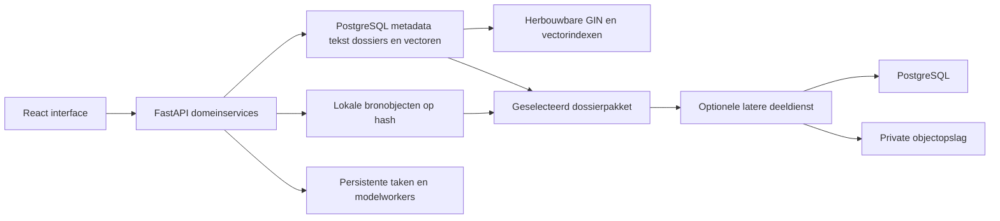

# Euraika Compass — Technologie en opslagarchitectuur

Status: aanbevolen architectuur, onderzocht op 8 november 2026. Er is nog geen backend geïnstalleerd, database aangemaakt of prestatietest uitgevoerd. [functional.md](functional.md) blijft leidend voor gedrag; dit document concretiseert de stack, bewaring en deelbaarheid.

## Keuze: PostgreSQL als standaard voor lokaal en centraal gebruik

De persoonlijke Pinokio-app gebruikt React/TypeScript en FastAPI, met PostgreSQL voor gestructureerde gegevens, PostgreSQL full-text search en pgvector voor semantisch zoeken. Grote bronobjecten staan in een afzonderlijke lokale bestandsopslag. Vanaf de eerste versie kunnen opgeslagen dossiers als gecontroleerd pakket worden geëxporteerd en geïmporteerd. Een latere centrale deeldienst gebruikt dezelfde PostgreSQL-gebaseerde datalaag en private objectopslag, met eigen authenticatie en toegangscontrole. Databasedirectories worden nooit via bestandssynchronisatie gedeeld.

De keuze is bijgesteld na de uitbreiding naar duurzaam en deelbaar onderzoek. PostgreSQL past bij gelijktijdige onderzoekstaken, rijke bronrelaties en een pad naar samenwerking. Zijn MVCC-concurrency is gedocumenteerd; deze productkeuze is geen gemeten performanceclaim. [PostgreSQL concurrency](https://www.postgresql.org/docs/current/mvcc-intro.html). SQLite blijft technisch bruikbaar voor een kleinere persoonlijke variant, maar is geen tweede verplichte backend of stilzwijgende fallback: één primaire engine houdt schema-, migratie- en zoekgedrag consistent. Er bestaat nog geen appdatabase die moet worden gemigreerd.

Dit voegt een te beheren databaseproces toe. U1 moet op Windows de vertrouwde PostgreSQL-distributie, pgvector-build/compatibiliteit, rechten, opslagpad, init/start/readiness/stop/backup en updates aantoonbaar maken. De pgvector-documentatie beschrijft afzonderlijke Windows-buildstappen; beschikbaarheid wordt niet aangenomen. Native of een expliciet gekozen containerinstallatie wordt pas na die proef vastgelegd. Geen verborgen vereiste dat de gebruiker zelf een service of Docker beheert. [pgvector-installatie](https://github.com/pgvector/pgvector), [PostgreSQL initdb](https://www.postgresql.org/docs/current/app-initdb.html).

## Stack

| Laag | Voorstel | Reden en begrenzing |
| --- | --- | --- |
| Frontend | [React](https://react.dev/learn), TypeScript, [Vite](https://vite.dev/guide/), CSS-kleurtokens | Chat/Research/Roundtable delen state en componenten. Een statische productiebuild wordt door de lokale backend aangeboden; geen verplichte SSR-server. |
| Lokalisatie | [i18next](https://www.i18next.com/) met React-integratie, logische CSS-richting | Engelse eerste start, EN/NL/AR/FR/DE-catalogi en RTL per interface/tekstblok. |
| Backend | Python, FastAPI, Uvicorn, Pydantic-contracten | Eén modulair backendproces met domeinservices voor bronnen, dossiers, onderzoek, rechten en providers. Lokale modelworkers draaien als beheerde afzonderlijke processen. |
| Voortgang | HTTP-opdrachten en [Server-Sent Events](https://fastapi.tiangolo.com/tutorial/server-sent-events/) | Voortgang en antwoorden streamen; toestand en herverbinding worden vanuit persistente runs afgehandeld. WebSockets alleen indien later daadwerkelijk nodig. |
| Datatoegang | [SQLAlchemy](https://docs.sqlalchemy.org/en/21/orm/session_basics.html), psycopg-driver, [Alembic](https://alembic.sqlalchemy.org/en/latest/tutorial.html) | Domeinmodellen, begrensde transacties en schemamigraties. Eigen Session per taak/verzoek, nooit een gedeelde Session voor parallelle persona's. [PostgreSQL-dialect](https://docs.sqlalchemy.org/en/21/dialects/postgresql.html). |
| Database | PostgreSQL met relationele constraints en selectief JSONB | Dossiers, bronmetadata, teksten, bewijsrelaties, revisies, taken en routeverwijzingen. JSONB is voor variabele metadata/configuraties; kernrelaties blijven expliciet. Exacte oorspronkelijke JSON-bestanden blijven als bronbytes bewaard. [JSONB](https://www.postgresql.org/docs/current/datatype-json.html). |
| Grote bestanden | Immutable bestanden met SHA-256-identiteit, via een BlobStore-interface | Geraadpleegde toegelaten scans, bronbestanden, toegelaten snapshots en afgeleide afbeeldingen. Metadata en verwijzingen staan in de DB; geen base64-afbeeldingen in berichten of JSON-velden. |
| Zoeken | PostgreSQL full-text search met GIN, pgvector plus lokale embedding-/rerankworkers | Corpus, embeddingruimte en indexrevisie blijven gekoppeld. Begin met exacte vectorvergelijking; HNSW pas na meting van snelheid, recall en geheugen. |
| Manuscriptviewer | [OpenSeadragon](https://openseadragon.github.io/) met IIIF waar ondersteund | Inzoomen en overlays; manifest/folio-/canvasnavigatie wordt door de app gekoppeld. Rechten en daadwerkelijke protocol-/broncompatibiliteit worden per bron toegelaten. |
| Langdurige taken | Persistente job-/runregistratie en begrensde workers | Onderzoek, downloads en indexering mogen geen vluchtige achtergrondcallbacks zijn. Herstart markeert onderbroken werk en herneemt alleen veilige, idempotente stappen. |
| Centrale deeldienst, later | Dezelfde PostgreSQL-datalaag, private objectopslag met S3-achtige interface, authenticatie en resource-ACL's | Publiceert uitsluitend gekozen dossiermomentopnamen. Geen automatische upload van de lokale DB of gelijktijdige toegang tot haar bestanden. |

Exacte versies en locks worden gekozen bij implementatietoelating. De relevante runtime, native libraries, licenties en beveiligingsupdates worden vastgelegd. Er worden nu geen libraries geïnstalleerd. Redis, Celery, een externe vectordatabase en een microserviceplatform zijn geen verplichte onderdelen van de eerste lokale versie.

## Drie opslaglagen

1. **Duurzame onderzoeksgegevens:** bronnen/revisies, gebruikte objecten, bewijsitems, onderzoeksvraag, notities, antwoorden, interpretaties, discussie en configuratieversies. Dit is de basis voor herstel en referenties.
2. **Grote bronobjecten:** eenmaal opgeslagen bytes met herkomst- en gebruiksrecords. Dossiers verwijzen ernaar. Eén identieke scan van 20 MB die in tien dossiers voorkomt vraagt circa 20 MB plus metadata, niet tien volledige beeldkopieën. Verschillende resoluties of bytes zijn afzonderlijke objecten met een relatie naar hun bron.
3. **Afgeleide gegevens:** embeddings, zoekindexen, previews en tijdelijke downloads. Ze hebben eigen revisies en bewaarbeleid en kunnen worden herbouwd. Een duurzaam geciteerde scan valt niet onder de opruimregels voor tijdelijke previews.

Gebruik voor runtimegegevens een door de app beheerde lokale datamap buiten Git, gesynchroniseerde OneDrive-mappen en netwerkshares. Op Windows is `%LOCALAPPDATA%/EuraikaCompass` een kandidaat; de uiteindelijke locatie is zichtbaar en veilig wijzigbaar. Dit wijzigt de huidige repositorylocatie niet. PostgreSQL krijgt een eigen cluster-/datadirectory en lokaal begrensde netwerktoegang. Credentials staan backend-only buiten dossierexport. Extern databasegebruik is een expliciete configuratie, geen automatisch gevolg van gekoppelde LLM-API's. Alleen consistente backups/exportpakketten worden naar een gekozen backupbestemming gekopieerd.

## Datamodel en indexen

| Groep | Kernentiteiten |
| --- | --- |
| Bronnen | Source, SourceRevision, Edition, Passage, Manuscript, Canvas/Folio, Alignment |
| Bestanden en rechten | Blob, AssetOrigin, AssetUsageRights, AssetReference, RetentionPin |
| Onderzoek | Dossier, DossierDraft, DossierRevision, ResearchRun, EvidenceItem, Claim, Citation, Interpretation |
| Gesprek | Conversation, Message, Participant, RoleAssignment, Round, RunEvent |
| Uitvoering | Job, ModelRevision, ProviderRoute, UsageRecord; secrets afzonderlijk buiten de DB-export |
| Delen | ExportManifest, ExportItem; later PublishedSnapshot en AccessGrant in de centrale dienst |

Exacte bron- en dossiermomentopnamen zijn immutable. Werknotities/drafts mogen gecontroleerd worden bijgewerkt; inhoudelijke analyses krijgen nieuwe revisies. Vermijd een volledige kopie van een bron in ieder bericht. Gebruik relaties tussen bewijs, bronrevisie en dossier. Een blobhash groepeert dezelfde bytes, maar vervangt nooit bronherkomst of gebruiksrechten: die kunnen per herkomst verschillen.

Geef persoonlijke onderzoeksobjecten vanaf het begin een workspace-/eigenaarscope; de lokale installatie heeft aanvankelijk één workspace. De centrale dienst koppelt dit aan echte gebruikers en toegangsrechten via expliciete migraties. Queries, zoeken en bestandslevering moeten dezelfde resourcegrenzen toepassen. Dezelfde database-engine voorkomt een enginewissel, maar maakt accounts, autorisatie en conflictafhandeling niet automatisch gereed. Deduplicatie mag geen omweg worden om het bestaan of de inhoud van andermans private objecten te achterhalen.

Voorzie foreign keys en uniqueness voor onder andere `(edition_id, passage_key)`, `(dossier_id, revision_number)`, `(conversation_id, sequence)` en `blob.sha256`. Indexeer de echte toegangspaden: dossier met wijzigingsdatum/id, berichten per gesprek/volgnummer, bewijslinks per dossier-/runrevisie, passages per editie/referentie en taken per status/beschikbaarheid. Gebruik keysetpaginering voor lange lijsten en laad de inhoud van geopende panelen pas wanneer nodig. Grote pagina's, gesprekken en bronobjecten worden niet telkens volledig opgehaald.

Maak aparte zoekrepresentaties met `tsvector` en een GIN-index; originele tekst en diakritiek blijven intact. Taalconfiguratie en normalisatie worden per taal getoetst, met een expliciete simpele tokenisatie waar geen toegelaten taalspecifieke verwerking bestaat. Toets Arabisch, Hebreeuws en oude talen; ingebouwde FTS is geen bewijs van taalkundige kwaliteit. [PostgreSQL tekstindexen](https://www.postgresql.org/docs/current/textsearch-indexes.html).

Embeddings staan in aparte pgvector-tabellen met stabiele passage-/chunk-IDs en model-, bron-, chunking- en indexrevisies. Combineer geen verschillende embeddingruimten; dimensies en afstandsfunctie moeten overeenstemmen. Exact zoeken is de baseline. Approximate indexen, filtering en parameters worden per collectie/taal met recall en performance vergeleken voordat HNSW wordt geactiveerd. Een gewijzigd document invalideert betrokken afleidingen; een nieuwe embeddingruimte krijgt een aparte relevante index. Geen herindexering bij iedere start. [pgvector](https://github.com/pgvector/pgvector).

## Schrijven, onderhoud en performance

Lokale startconfiguratie: één API-proces, beheerde modelprocessen en PostgreSQL met een kleine begrensde connection pool. Iedere parallelle taak gebruikt een eigen korte sessie en geeft verbindingen vrij buiten DB-werk. Meerdere modelcalls veroorzaken niet ieder een onbeperkte nieuwe DB-verbinding. Autovacuum blijft actief; tabellen met veel draft-/statusupdates worden op bloat, dead tuples en statistieken gevolgd.

- Gebruik relationele constraints, passende connection-/statement-/locktimeouts en geteste transacties. Houd WAL-durability actief; zet `fsync` of synchrone commit niet onbeoordeeld uit. Kies buffer-, werkgeheugen- en poollimieten op gemeten RAM en gelijktijdige belasting, niet op alleen de hoeveelheid GPU-VRAM.
- Houd transacties kort. Wacht nooit op een cloudantwoord, download of GPU binnen een geopende schrijftransactie. Werk in begrensde batches.
- Stuur streamingtokens naar de UI; checkpoint herstelbare conceptuitvoer in batches en bewaar afgeronde berichten. Geen DB-commit per token of per ingedrukte toets. Autosave van drafts wordt gedebounced en toont de laatst bevestigde bewaartoestand.
- Gebruik persistente jobstatus en herstelpunten. Controleer of een externe opdracht werkelijk beëindigd is; herstart na een onbekende cloudresponse mag geen onbedoeld dubbel betaalde generatie starten.
- Meet query-p50/p95, lock-/commitwachttijd, connection-pooluitputting, WAL/DB-omvang, indexgrootte, cachegedrag en achterstallige jobs. Gebruik `pg_stat_statements` met beperkte toegang; die statistieken kunnen querytekst bevatten, dus geen persoonlijke promptinhoud in SQL-literals of algemene diagnostiek. Onderzoek plannen met `EXPLAIN`; `EXPLAIN (ANALYZE, BUFFERS)` voert de query echt uit en wordt gecontroleerd op geschikte test-/leesqueries gebruikt. [EXPLAIN](https://www.postgresql.org/docs/current/using-explain.html).
- Laat autovacuum/analyze werken en tune op waargenomen update-/importbelasting. Geen `VACUUM FULL`, volledige herindexering of vroege partitionering bij iedere start. Batch imports; werk indexen incrementeel bij en plan zwaarder onderhoud beheerst.

Back-up en onderhoud worden getest naast imports, Roundtable en bronweergave. De server blijft begrensd door bronrechten, RAM, schijf en echte query-/modelbelasting. Eén PostgreSQL-service maakt de app niet automatisch schaalbaar en bewijst geen antwoordkwaliteit; passende indexen, transacties, toegangscontrole en herstel blijven noodzakelijk.

## Automatisch bewaren van geraadpleegde bronbeelden

Een toegelaten, daadwerkelijk opgehaald bronbeeld wordt bij onderzoek automatisch opgenomen voor hergebruik wanneer de gebruiksvoorwaarden blijvende lokale bewaring toestaan en er ruimte beschikbaar is. Een zoekhit alleen leidt niet tot het downloaden van volledige manuscripten. Reeds geraadpleegde openbare bronobjecten kunnen los van een persoonlijk gesprek worden hergebruikt; tijdelijke persoonlijke chatinhoud wordt daardoor niet stilzwijgend een dossier of achtergrondgeheugen.

De assetpipeline doet het volgende:

1. Controleer officiële bron/delegatie en de afzonderlijke rechten voor bekijken, tijdelijk cachen, duurzaam lokaal bewaren, afleiden, exporteren en extern verwerken. Onbekende status geeft geen automatische toestemming.
2. Leg catalogus-/bron-URL, afbeelding/service-URL, instelling, signatuur, folio/canvas, resolutie, formaat, raadpleegtijd, attribution, voorwaarden en rechtenreview vast. Bij IIIF worden relevante manifest-/canvasgegevens en `requiredStatement`/`rights` verwerkt. De standaard maakt rechteninformatie inspecteerbaar maar verleent op zichzelf geen gebruiksrecht. [IIIF Presentation](https://iiif.io/api/presentation/3.0/).
3. Download naar staging met limieten, valideer type/inhoud, bereken SHA-256 en plaats de bevestigde bytes atomair onder hun hash. Daarna volgt de DB-transactie die oorsprong, rechten en dossierverwijzingen vastlegt. Omdat bestandssysteem en DB geen gezamenlijke transactie hebben, detecteert herstel ontbrekende objecten en verweesde staging/objecten; verwijdering heeft een wachttijd en referentiecontrole.
4. Bewaar gebruikte toegelaten originele bytes ongewijzigd; thumbnail, crop of afgeleide tegelpiramide krijgt een eigen identiteit en ouderrelatie. Een bekeken tegel of preview wordt nooit als volledige hoogresolutiescan beschreven. Geen automatische volledige IIIF-mirror of samengestelde scan als zogenaamd origineel.
5. Koppel een gebruikt object aan de onderzoeks-/dossierrevisie met een retentiepin. Een nieuwe remote versie levert een nieuwe hash/revisie; oude aangehaalde bytes worden niet overschreven zolang hun bewaring is toegelaten.
6. Toon `Local copy retained`, `Temporary cache`, `Remote reference only`, `Retention blocked` of een concrete opslagfout. Een hash zonder bewaarde bytes krijgt geen offline-beschikbaarclaim. Attributie, hash en beschikbaarheid bewijzen op zichzelf geen historische authenticiteit.

De bronnen verschillen echt: de IAA-voorwaarden noemen een beperkte privé-kopie-uitzondering en beperkingen op verder gebruik; Birmingham biedt beelden voor privéstudie en vraagt contact voor publicatie. Dit zijn geen generieke toestemmingen voor een gedeelde beeldbank. [IAA-voorwaarden](https://www.deadseascrolls.org.il/terms?locale=en_US), [Birmingham image access](https://www.birmingham.ac.uk/facilities/cadbury/birmingham-quran-mingana-collection/birmingham-quran/free-access-images). Elke bronadapter legt de toegelaten concrete gebruiksvormen vast.

Stel een zichtbare opslaglimiet in. Tijdelijke niet-vastgezette previews mogen volgens recent gebruik verlopen; geciteerde toegelaten bronobjecten en dossierinhoud worden niet stilzwijgend opgeruimd. Bij een volle schijf pauzeert bewaring/download en blijft zichtbaar welk onderzoek nog niet volledig is opgeslagen. Een noodzakelijke rechtenbeperking krijgt een expliciete beschikbaarheidsmelding en behoud van toegestane verwijzingen. Gebruik geen generieke bestandsexpiratie op de duurzame onderzoeksobjecten.

## Onderzoek bewaren en delen

Een gebruiker die `New research` start of expliciet een chat in een dossier omzet, krijgt een lokaal onderzoeksdossier met automatische draftbewaring en herstelbare runstatus. De UI toont bewaren/bevestiging/fout. Afgeronde analyse maakt een nieuwe versie; heranalyse behoudt de vorige. Gewone levensvragen in een tijdelijke Chat worden niet automatisch duurzame dossiers.

**Eerste deelroute:** exporteer een gekozen dossierrevisie als versieerbaar `*.compass.zip`-pakket met een JSON-manifest, leesbaar Markdown-rapport en uitsluitend toegelaten bronbestanden. Het manifest noemt IDs, relaties, bron-/model-/policyversies, hashes, attributie, rechten en ontbrekende objecten. Geen ruwe appdatabase, API-keys of onbedoeld volledige persoonlijke chatgeschiedenis. De gebruiker kiest persoonlijke notities/discussie bewust voor opname en controleert het exportoverzicht. Import valideert schema, IDs, hashes, bestandspaden en omvang, en bewaart het dossier als afzonderlijke herkomst/revisie zonder lokale dossiers te overschrijven.

**Latere linkroute:** opt-in publicatie van een gekozen momentopname naar een aparte deeldienst met PostgreSQL en private objectopslag. De gebruiker kiest leestoegang; autorisatie wordt ook bij bestandslevering gecontroleerd. Publieke links, beperkte toegang en toegangsintrekking krijgen afzonderlijke tests. Intrekken beëindigt toekomstig ophalen via die route, niet reeds gedownloade kopieën. Gedeelde interpretaties blijven toegeschreven aan hun auteur/model en zijn geen door Compass gecertificeerde conclusie.

Deeldienst en lokale app delen een dossierformaat, PostgreSQL-schema-/repositorycode en opslaginterfaces. Publicatie is een gecontroleerde overdracht van geselecteerde revisies, geen live synchronisatie van databasedirectories. De oorspronkelijke bronrechten worden per object opnieuw op delen beoordeeld. Lokale bewaartoestemming is geen deeltoestemming. Een pakket kan daarom wel het onderzoek, de referentie en het folio bevatten terwijl de ontvanger het beeld via de officiële instelling moet openen. Realtime gezamenlijk bewerken, accounts en conflictoplossing blijven een afzonderlijke uitbreiding; dossierexport vereist die infrastructuur niet.

## Back-up, herstel en verificatie

Gebruik consistente PostgreSQL-backups met `pg_dump`/`pg_restore` voor de eerste lokale versie, met schema-/extensionversies en herstelproef. De database en het manifest van gebruikte immutable blobs moeten hetzelfde backupmoment vertegenwoordigen, bijvoorbeeld met een gedeelde geëxporteerde snapshot en `pg_dump --snapshot`; houd de benodigde blobs vast tot de backup is geverifieerd. Een backupjob kan bewust langer een snapshot vasthouden en wordt buiten de gewone UI-transacties bewaakt/begrensd. Kopieer niet willekeurig een actieve PostgreSQL-datadirectory. Voor grotere centrale installaties kan een afzonderlijk ontworpen fysieke backup-/WAL-archiefroute nodig zijn. [SQL dump](https://www.postgresql.org/docs/current/backup-dump.html), [pg_dump snapshot](https://www.postgresql.org/docs/current/app-pgdump.html).

Kopieer en controleer de bijbehorende bronbytes; zoekindexen kunnen worden herbouwd, maar gebruikte bronbestanden en notities zijn niet vervangbaar door alleen een hash. Een back-up blijft lokaal/privé tenzij de gebruiker een andere bestemming kiest. Secrets hebben een afzonderlijke lokale herstelroute en worden niet in een deelbaar onderzoeksdossier opgenomen.

Test restore op een aparte locatie, met DB-integriteit, foreign keys, assethashes, ontbrekende bestanden, bronrechten en dossierheropening, vóór een herstelde versie actief wordt. Schemawijzigingen hebben migratieversies en een geteste backup-/herstelroute. Aparte dump-/objectbackup en herstelprocedures gelden voor de latere centrale dienst. Daar worden onder andere autovacuum en querygedrag gevolgd. [PostgreSQL maintenance](https://www.postgresql.org/docs/current/routine-vacuuming.html), [pg_stat_statements](https://www.postgresql.org/docs/current/pgstatstatements.html).

Vereiste acceptatieproeven: gelijktijdig lezen/onderzoek/import zonder langdurige locks; hergebruik van dezelfde scan zonder tien bestandskopieën; twee herkomsten met verschillende rechten; een gewijzigde bron als nieuwe revisie; tijdelijk beeld niet ten onrechte offline; geciteerd beeld overleeft cacheopruiming; schijf-vol tijdens download/autosave; crash tussen blobplaatsing en DB-commit; FTS-/vectorherbouw; offline dossierheropening; veilige export/import met toegestane versus geblokkeerde beelden; geen secrets/persoonlijke chat bij ongevraagde export; complete backup/restore; en voor online delen resource-autorisatie en intrekking. Voor performance worden aantallen, corpus-/indexrevisies, hardware, p50/p95 en lockmetrieken gepubliceerd. In dit plan staan geen fictieve benchmarkresultaten.
